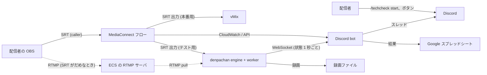
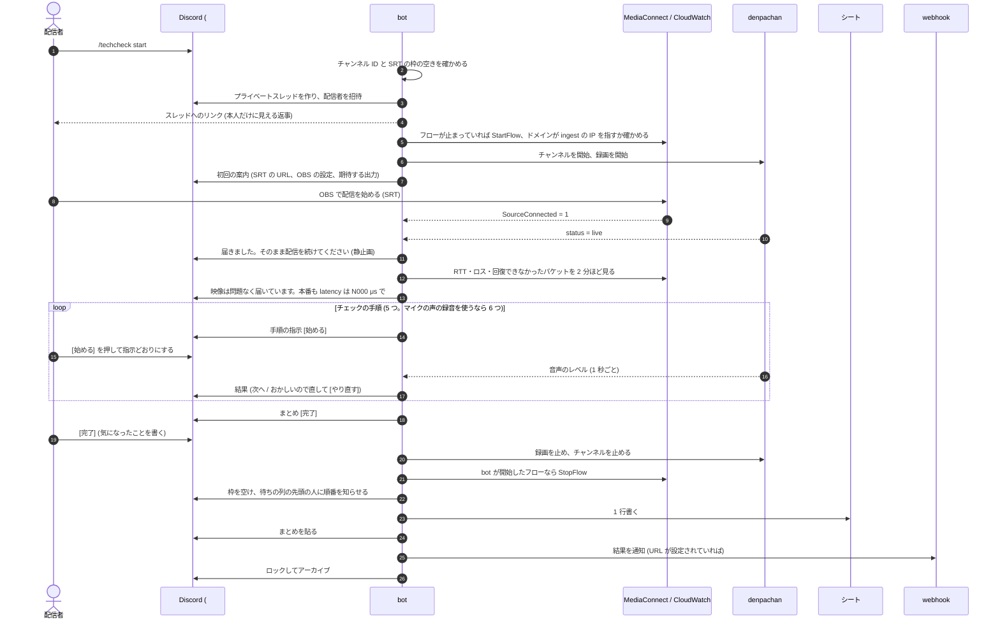

# 配信テストの自動化 (Discord bot とメトリクスの受信口) の設計

イベント前に各配信者と行う配信テストを、Discord bot で進める。**配信者が好きな時間にスラッシュコマンドで起動**し、
bot がスレッドで案内しながら、配信が届いたことの確認、**SRT の latency の調整**、RTMP への切り替え、音声とその他のチェックの指示までを行う。
運営はその場にいなくてよい。

テストも本番も、配信者 → **MediaConnect** → 運営の経路で行う。latency を決める区間は配信者 → MediaConnect なので、
その数字は **MediaConnect (CloudWatch と API) から**取る。運営側の denpachan は、フローの出力を受けて
デコードの良否・音声のレベルを見て、録画を残す。そのために engine に **メトリクスの受信口** (WebSocket、待ち受けポート 1 つ) を足す。
音声の最終的な判定 (ゲーム音だけが載っているか、ノイズ) は、bot がチェックの手順をさせた区間を録画で後日人が聞いて行う。

この文書は、はじめ [denpachan](https://github.com/RTAinJapan/denpachan) のリポジトリの `docs/stream-test-automation.md` にあった。
bot (このリポジトリ) と、denpachan の engine の側 (メトリクスの受信口。§3.2) の両方を扱う。
受信口の仕様 (§3.2) は、[denpachan の `docs/stream-test-automation.md`](https://github.com/RTAinJapan/denpachan/blob/main/docs/stream-test-automation.md) が正で、ここはその写し。
ファイルの場所は、「denpachan の」と書いたもの以外は、このリポジトリの中のもの。

- [1. 今の運用と、自動化する範囲](#1-今の運用と自動化する範囲)
- [2. 全体の構成](#2-全体の構成)
- [3. bot の情報源](#3-bot-の情報源)
  - [3.1 MediaConnect (配信者 → MediaConnect の区間)](#31-mediaconnect-配信者--mediaconnect-の区間)
  - [3.2 denpachan のメトリクスの受信口 (MediaConnect → 運営の区間、デコード、音声、録画)](#32-denpachan-のメトリクスの受信口-mediaconnect--運営の区間デコード音声録画)
- [4. Discord bot](#4-discord-bot)
- [5. テストの流れ](#5-テストの流れ)
- [6. 配信の確認と latency の調整](#6-配信の確認と-latency-の調整)
- [7. 音声とその他のチェック](#7-音声とその他のチェック)
- [8. 記録 (シート)](#8-記録-シート)
- [9. 実装](#9-実装)
- [10. 決めていないこと・注意](#10-決めていないこと注意)

## 1. 今の運用と、自動化する範囲

| 今の手順 | 自動化 | 根拠 |
| --- | --- | --- |
| 配信者と運営が時間を合わせ、Discord で通話する | **配信者が好きな時間に `/techcheck start` で起動する (イベント中も)。** SRT の枠は既定で 1 つなので、テストは同時に 1 人 (枠を増やせば、その数だけ同時に進められる。§5.7)。空いていればすぐ始まり、bot が配信者ごとのスレッドで案内する。空いていなければ待ちの列に入り、順番が来たら知らせる。通話はしない | 時間を合わせる手間をなくす (§5.1) |
| 配信者が MediaConnect に SRT で送る、運営が vMix で受ける | **bot が MediaConnect の接続状態 (`SourceConnected`) と denpachan の受信状態を見て、配信が届いたことを確かめる** | §3 |
| 映像が乱れずに表示できること | **少しの間 (1〜2 分) 配信させ、bot が MediaConnect の取りこぼし (`SourceNotRecoveredPackets`)・CC エラーと、denpachan のデコードエラー・fps で判定し、結果を配信者に伝える** | 回復できなかったパケットとデコードエラーが 0 で fps が出ていれば、映像は乱れていない。静止画 (denpachan の録画から取る) もスレッドに貼る |
| 乱れるときは latency を上げてもらう。上げても直らなければ RTMP にする | **bot が値を決めて配信者に伝え、配信者が OBS の設定を変えて始め直す (§6)。** 直ったかどうかは bot が見る。上げても直らなければ bot が RTMP (ECS の RTMP サーバ) の案内に切り替える | latency は配信者の OBS の設定に持たせる (本番でもその値で送ってもらう)。MediaConnect の `MinLatency` は低いまま固定し、実際の latency は OBS の値で決まるようにする (大きい方が使われる) |
| 音声が正しく来ていること、ノイズが無いこと | **bot がチェックの手順 (ゲーム音を鳴らす、静かにする) を順にさせ (§7)、その区間を録画の時刻とともに記録する。** 後日、人が録画のその区間を聞いて判定する | 判定は録画でできる。手順をそろえておけば、聞く側は決まった区間だけを聞けばよい |
| ゲーム音だけが載っていること (マイク音は別経路) | **同上。** しゃべる、デスクトップの音を鳴らす、の手順をさせる。その間に音が載ればマイク・デスクトップ音が混ざっている | denpachan の音声レベルで、その場の参考の判定もできる。明らかに混ざっていればその場で直してもらう |
| マイクの音質を、Discord の通話 (ボイスチャンネル) で聞いて確かめる | **bot がボイスチャンネルに入り、配信者の声を録音してファイルに残す (§7.3。使うときだけ)。** 後日、人がファイルを聞いて判定する | 音質の良し悪しは機械では決めにくい。声が届いたか、割れていないか、小さすぎないかだけ、その場で bot が見る |
| 結果をシートに記録する | **bot が書く (§8)。** 音声の判定の欄だけ、後日人が埋める | |

## 2. 全体の構成



- **テストの枠は、既定で SRT 1 つ、RTMP 1 つ。** SRT の枠は、設定で増やせる (同時にテストできる人数になる。§5.7)。RTMP の枠は 1 つだけ。どのフロー・どの denpachan のチャンネルを使うかは、**そのとき空いているものを運営が設定し直す** (`/techcheck slot`。イベント中も。§5.6)。
- **配信者には IP アドレスではなくドメイン名で接続させる。** SRT のフローごとと、ECS の RTMP サーバに、配信用のドメインが設定されている。bot はフローとドメインを**組で**設定に持ち、案内にはドメイン名を使う。
- **MediaConnect**: SRT の枠には、そのとき空いているフロー (source は SRT listener、配信者が caller) を使う。そのフローには denpachan 向けの **SRT の出力**を足しておく (vMix 向けの出力はそのまま。1 つのフローの出力は複数持てる)。source の `MinLatency` は低い値 (100 ms 以下) で固定し、bot は変えない。
- **ECS の RTMP サーバ**: SRT で安定しないときの受け口 (すでに動いているもの)。配信者はそこへ RTMP で送り、denpachan はそこから RTMP pull で受ける (`source.protocol = rtmp`、`mode = pull`)。本番で RTMP の配信者をどう受けるか (vMix が pull する、など) はそのまま。
- **denpachan**: 本番の受信と同じ denpachan で、そのとき空いているチャンネルを SRT の枠 (MediaConnect のフローの出力を受ける) と RTMP の枠 (ECS の RTMP サーバから pull する) に 1 つずつ使う。録画 (passthrough) を残す。**bot が操作できるのは「配信テスト用」の印を付けたチャンネルだけ**にして、イベント中に本番のチャンネルを触らないようにする (§3.2)。
- **bot**: denpachan とは別のプログラム (このリポジトリ。Node.js + TypeScript。§4)。AWS の権限 (MediaConnect と CloudWatch の読み取り、フローの開始・停止) を持つ。denpachan と同じ PC で動かすのが簡単 (受信口は loopback)。別の PC でもよい (LAN、トークン必須)。
- **区間ごとの役割**: 配信者 → MediaConnect の区間 (回線が悪くなりうる所) の数字は MediaConnect から、MediaConnect → 運営の区間 (安定している所) とデコード・音声は denpachan から。RTMP のときは、denpachan の pull の受信状態 (映るか、fps、デコードエラー) だけで判定する。
- **配信者の OBS の設定を変えるのは配信者**: bot は値を決めて伝え、変えたことの申告 (ボタン) と、変えたあとの数字で確かめる。

## 3. bot の情報源

### 3.1 MediaConnect (配信者 → MediaConnect の区間)

bot が使う API とメトリクス。すべて AWS SDK for JavaScript v3 から (`src/adapters/aws.ts`)。

| 用途 | API / メトリクス | 使い方 |
| --- | --- | --- |
| フローの状態、source の設定 (ingest の IP とポート、プロトコル、`MinLatency`) | `DescribeFlow` | テストの準備で、案内するポートと、組にしたドメインがこのフローの ingest の IP を指していること (§5.1) を確かめる。`/techcheck slot srt` では、source が SRT listener で `MinLatency` が案内の初期値以下 (OBS の値が効く状態) であることも確かめる (§5.6) |
| フローの開始・停止 | `StartFlow` / `StopFlow` | テストの準備でフローが止まっていれば開始し (ACTIVE になるまで最大 4 分待つ)、終わったら止める (動いている間は課金されるので)。**止めるのは bot が開始したフローだけ** (もともと動いていたフローは止めない) |
| 接続しているか | CloudWatch `SourceConnected` (1 / 0)、`SourceUpTime` | 繋がった・切れた。`SourceUpTime` が戻ったら繋ぎ直したとみなす |
| RTT | `SourceRoundTripTime` (ms) | 推奨値の計算 (窓の最大) |
| ロス | `SourcePacketLossPercent` (%)、`SourceTotalPackets`、**`SourceNotRecoveredPackets`** | ロス率は倍率の決定 (1 秒ごとのロス率と受信数から、窓全体のロス率を出す)、回復できなかったパケットは「今の latency では足りない」の判定 |
| 揺れ | `SourceJitter` (ms) | 記録と、RTMP に移す判定 (§6) |
| ビットレート | `SourceBitRate` (bps) | 記録 (窓の平均) |
| TS の壊れ | `SourceContinuityCounter`、`SourceTSSyncLoss` | 安定の確定の条件 (§6) |
| 解像度・fps・コーデック | `DescribeFlowSourceMetadata` (`TransportMediaInfo.Programs[].Streams[]` の `FrameResolution`、`FrameRate`、`Codec`、`StreamType`) | 繋がったときに 1 回、期待する出力 (`guide.expected`) と比べる。音声ストリームの有無もここで分かる。fps は判定の基準にも使う |
| 静止画 (予備) | `DescribeFlowSourceThumbnail` (Base64 の JPEG。フローの `SourceMonitoringConfig.ThumbnailState` を ENABLED にしたときだけ使える) | 静止画は denpachan の録画から取る (下の「配信の静止画」)。録画から取れないとき (bot が別の PC にある、ffmpeg が無い、録画が始まったばかり) の予備として、SRT のときだけこちらを使う |

- CloudWatch は `GetMetricData` で、**1 秒の粒度**のメトリクスを 10 秒ごとに直近 4 分ぶん取り、bot の中で秒ごとに溜める (反映が数十秒遅れることがあるので、遅れて届いた秒も拾えるように長めに取る。高解像度のメトリクスは 3 時間残る)。名前空間は `AWS/MediaConnect`、ディメンションは `FlowARN` (フローの source は 1 つ)。
- **推奨 latency の計算は bot が行う** (denpachan の `src/worker/srt_advisor.h` と同じ規則を bot に写す。`src/advisor.ts`): 窓 (`judge.windowSec`、既定 60 秒) の RTT の最大 × 倍率 (ロス率 〜1%: 3、〜3%: 4、〜7%: 6、〜10%: 8、それ以上: 10。`judge.multipliers`)。窓の中に `SourceNotRecoveredPackets` があれば今の 1.5 倍以上。下限 20 ms、10 ms 単位に切り上げ。接続直後の 5 秒は使わない。データのある秒が 10 秒分に満たなければ「計測中」。AWS の目安「latency は RTT のピークの 3 倍以上」と同じ考え方で、ロスが多いときに倍率を上げる分だけ厳しい。
- 余裕 (`headroomMs`) と `verdict` (§3.2 の表と同じ区分) もここから作る。実際の latency は「配信者の OBS の値」と「`MinLatency`」の大きい方で、`MinLatency` は低く固定するので OBS の値が効く。**OBS の値は bot からは見えない。** bot は「案内した値」を実際の latency とみなし、頼んだあとに繋ぎ直したこと (`SourceUpTime` が戻った、または denpachan の `connectedSec` が戻った・`live` が途切れて戻った) を確かめてから、次の計測に進む (§6)。

#### RTMP (ECS の RTMP サーバ) の区間

- denpachan の pull の受信状態 (`status`、`video.fps`、`video.decodeErrors`) だけで判定する。RTMP の pull には TCP の統計が無い (`tcp` は null) ので、再送は見ない。
- RTMP サーバの統計 (nginx-rtmp の `/stat`、SRS の HTTP API など) は使っていない。設定の `rtmp.statsUrl` は置いてあるが、今は読まない (§10)。
- MediaConnect を通らないので、`DescribeFlowSourceMetadata` による設定の比べは無い。静止画は、SRT と同じく denpachan の録画から取れる。

#### 配信の静止画

繋がったとき、チェックの「画面」の手順、`/techcheck shot` で、配信の静止画をスレッドに貼る (運営が vMix を開かずに絵を見られる)。

- **denpachan の録画から取る。** denpachan はテストの間ずっと録画しているので (SRT の枠も RTMP の枠も)、bot が ffmpeg で、録画の「今」の 2 秒手前の 1 枚を取り出す (`src/adapters/still.ts`)。録画中のファイルは長さが分からないので、末尾からではなく、denpachan が出す録画ファイルの中の位置 (`record.position`) から位置を決める。録画が 3 秒たまるまでは取らない。
- `record.position` は、書いているファイルの時間軸で、最後に書いたパケットの時刻 (ファイルの先頭が 0)。`record.seconds` (録画を始めてからの時間) は使わない: 配信が途切れた時間はファイルに入らないので、途切れたあと (latency を変えて OBS を始め直すと 10 秒ほど) は、その分だけファイルの終わりより先を指す。`position` を出さない版の denpachan のときだけ `seconds` で代える (`src/service.ts` の `recordingPosition`)。
- その位置にフレームが無ければ (`position` は 1 秒ごとの値で、書いたパケットがファイルに出るまでにも少し間がある。`seconds` で代えたときは途切れた分だけずれる)、手前へ探しに行き (5、10、20 秒…)、見つかったらファイルの終わりに寄せる。分かった遅れは録画ごとに覚えて、次は最初からその位置を試す。
- フローのサムネイルの設定が要らず、RTMP でも使える。bot と denpachan が同じ PC (または録画先を同じパスで見られる PC) で動いていることと、ffmpeg (`ffmpeg.path`。既定は PATH の `ffmpeg`) が要る。
- 録画から取れないときは、SRT なら MediaConnect のサムネイル (上の表の「静止画 (予備)」) を試す。
- どちらでも取れないときは、静止画なしで案内し、理由 (試した方法ごと) を運営に知らせる (同じテストでは 1 回だけ。録画が始まったばかりで取れないだけのときは知らせない)。「画面」の手順では、「OBS のプレビューを見て答えてください」と添える。
- 配信者に案内するのは RTMP の URL (`rtmp://<RTMP サーバのドメイン>/<app>`) とキー (bot の設定に持つ)。denpachan のそのチャンネルの pull の URL も同じキーにしておく。

### 3.2 denpachan のメトリクスの受信口 (MediaConnect → 運営の区間、デコード、音声、録画)

今の IPC (`\\.\pipe\denpachan`、[denpachan の `docs/design.md`](https://github.com/RTAinJapan/denpachan/blob/main/docs/design.md) §10.2) は名前付きパイプで、同じ PC の同じユーザーからしか繋げない。bot のために、**同じ内容を TCP の WebSocket で出す口**を engine に足す。画面と `denpachan-ctl` は今までどおりパイプを使う。

bot がここから使うのは: 受信の状態 (繋がっている、映像が出ている、途絶)、デコードの良否 (デコードエラー、fps、解像度)、音声のレベルと無音、録画の状態とファイル名。SRT の数字 (`latency` の項目) は MediaConnect → denpachan の区間のもので、**配信者の latency の判断には使わない** (この区間が悪いときは運営側の問題として別に伝える)。

#### 設定

`general.metrics` を足す (全体設定の画面にも出す)。

```json
"metrics": { "enabled": false, "bind": "127.0.0.1", "port": 9100, "tokenProtected": "", "allowControl": false }
```

| 項目 | 内容 |
| --- | --- |
| `enabled` | 既定 off。テストをイベント中も受け付けるので、テストの期間中 (イベント中を含む) は on |
| `bind` / `port` | 既定は loopback の 9100 (SRT の 9001〜9008 と離す)。RTMP サーバ (`rtmpServer.port`) と同じポートは設定を受け付けない。別の PC の bot から繋ぐなら `0.0.0.0` |
| `token` | 共有の秘密 (16〜128 文字、空白と制御文字なし)。**loopback 以外に bind するときは必須** (無ければ設定を受け付けない。設定ファイルを直接書き換えて無い状態になっていたら、engine は待ち受けずにログに出す)。パスフレーズと同じく DPAPI で保存する (`tokenProtected`)。IPC では返さず、設定済みかどうか (`hasToken`) だけ返す。画面に「作り直す」ボタン (32 バイトの乱数、Base64url。保存するまでの間だけ表示) |
| `allowControl` | 操作のメソッド (下) を許すか。既定 off (読むだけ)。bot にチャンネルと録画の開始・停止をさせるなら on。on でも、操作できるのは「配信テスト用」のチャンネルだけ。変えても受信口は開き直さない (要求ごとに見る) |

設定が変わると engine は受信口を開き直す。ポートが使われているなどで待ち受けられなければ、10 秒ごとにやり直す。

チャンネルの設定に **`testSlot`** (チャンネル設定の画面の「配信テスト用 (bot が操作してよい)」) を足す。運営がテストの枠を設定し直すとき (§5.6) に、そのチャンネルに印を付け、外したチャンネルの印を外す。イベント中は同じ denpachan で本番のチャンネルが動いているので、bot の不具合や枠の設定の間違いで本番のチャンネルを止めたり録画を切ったりしないよう、**engine の側で**操作の対象を印のあるチャンネルに限る。

TLS はしない (家庭内 LAN か同じ PC で使う。外から繋ぐなら VPN か ssh のトンネルを通す)。

#### プロトコル

WebSocket (RFC 6455)、テキストフレーム、1 フレームに JSON 1 つ。

- 接続: `GET /ws HTTP/1.1` + `Upgrade: websocket`。ほかのパスは `404`。
- 認証: トークンを設定していれば、`Authorization: Bearer <token>` ヘッダか `?token=<token>` (ヘッダを付けられないクライアント向け。ほかの引数と並んでいてもよい)。合わなければ `401`。トークンが空 (loopback のとき) なら認証しない。
- **ブラウザからの接続は断る**: `Origin` ヘッダが付いていれば `403`。loopback でトークン無しのとき、利用者が開いた Web ページのスクリプトから繋がれないようにするため (bot の Node.js の WebSocket は `Origin` を付けない)。
- 繋がったら engine が `hello` を 1 つ送る。以後 1 秒ごとに `channels` を送る (engine の 200 ms の監視の 5 回に 1 回、`state` の通知と同時に作る)。
- 要求 / 応答はパイプと同じ形: `{"id": 1, "method": "getState", "params": {}}` → `{"id": 1, "result": ...}` / `{"id": 1, "error": "..."}`。壊れた JSON には `id` が null の `error` を返し、切らない。受け取る 1 メッセージは 1 MB まで。
- ping / pong は WebSocket の制御フレームで。engine は 10 秒ごとに ping を送り、30 秒何も届かない相手を切る。クライアントからの close には、受け取ったコードをそのまま入れた close を返してから切る。
- 同時接続は 8 まで (9 本目は `503`)。書き込みが 1 秒待っても進まない相手 (受け取らない bot) は切る。**engine の tick を止めない** (パイプの `broadcast` と同じ作り: クライアントごとのスレッドとキュー (64 件)、溢れたら古いものから捨てる)。

#### `channels` メッセージ

1 秒ごと。全チャンネル分 (8 チャンネル。止まっているチャンネルも `status: "stopped"` で入れる。bot が「どのチャンネルが空いているか」を知るため)。項目の組み立ては denpachan の `src/engine/metrics_view.cpp`。

```json
{
  "event": "channels",
  "time": "2026-11-01T12:34:56.789Z",
  "channels": [
    {
      "ch": 1, "name": "Runner A", "enabled": true, "inUse": true, "testSlot": true,
      "status": "live",
      "source": { "protocol": "srt", "mode": "caller", "host": "203.0.113.5", "port": 5000, "peer": "203.0.113.5:5000", "connectedSec": 83 },
      "video": { "codec": "h264", "width": 1920, "height": 1080, "fps": 59.9, "outputFps": 60, "bitrateMbps": 6.1, "hwDecode": true,
                 "decodeErrors": 0, "droppedLate": 0, "droppedQueue": 0 },
      "latency": {
        "effectiveMs": 300, "receiverMs": 300,
        "rttMs": 12.0, "lossPct": 0.0, "drops": 0, "windowSec": 60,
        "recommendMs": 40, "multiplier": 3,
        "headroomMs": 260, "droppedLastMin": 0,
        "verdict": "generous"
      },
      "tcp": null,
      "audio": { "peakDb": [-9.5, -9.8], "gaps": 0, "silentSec": 0 },
      "record": { "state": "recording", "file": "D:\\rec\\1 - 202611\\01 12-33-10.mkv", "seconds": 106, "position": 96.2 },
      "rejectedSenders": 0,
      "lastError": null
    }
  ]
}
```

| 項目 | 元 (`state` の項目) | 意味 |
| --- | --- | --- |
| `inUse` | 全体設定のチャンネル数 | このチャンネルが全体設定のチャンネル数の内か |
| `status` | `worker.state`、`video.state`、`video.connected`、`lastError` | 画面のタイルとほぼ同じ区分: `stopped` / `starting` (worker は動いているが、まだメトリクスが届かない。画面の「起動中」) / `listening` / `connecting` (caller・pull) / `waiting` (繋がったが映像がまだ) / `live` / `hold` (途絶、最後の絵を保持) / `unreachable` (caller・pull で繋がらない。`lastError` に理由) / `restarting` / `unavailable` (FFmpeg が無い)。画面と違うのは、listener (SRT listener、RTMP push) が繋がって映像がまだのときも `waiting` にすること (画面は「待ち受け中」のまま。bot は繋がったかを知りたいので細かく分ける) |
| `source` | チャンネルの設定 | `protocol`、`mode`。SRT は `port` (caller なら `host` も)、RTMP push は `app`。`peer` は繋がっている相手 |
| `source.connectedSec` | `video.connected` が立ってからの秒数 (engine で数える) | 繋がってからの時間。繋ぎ直すと 0 に戻る |
| `video` | `video.*` | worker のメトリクスが無いとき (止まっている、起動中) は null。`fps` は `video.decodeFps` (受信した映像の fps) |
| `latency` | `srt.latencyMs`、`srt.configuredLatencyMs`、`srt.recommend.*` | SRT のときだけ (それ以外は null)。**MediaConnect → denpachan の区間**の、実際の latency、受信側の設定値、RTT・ロス率・取りこぼし・窓の秒数、推奨値と倍率、余裕 (`effectiveMs − recommendMs`。計測中は null)、直近 60 秒の取りこぼし (`droppedLastMin`)、判定 |
| `latency.verdict` | 画面の経路の行の色と同じ規則 | `measuring` (推奨値がまだ無い) / `insufficient` (直近 60 秒に取りこぼしがある = 画面の赤) / `tight` (推奨値 > 実際の latency = 画面の黄) / `ok` / `generous` (実際の latency が推奨値の 2 倍以上) |
| `tcp` | `tcp.*` | RTMP push のときだけ (それ以外は null。**RTMP pull には TCP の統計が無い**)。`rttMs`、`retransBytes`、直近 60 秒の再送 (`retransBytesLastMin`)、`verdict` (`ok` / 再送があれば `tight`) |
| `audio` | `audioIn.*` | worker のメトリクスが無いときは null。`peakDb` (左右、dBFS)、`gaps`、`silentSec` (両チャンネルとも −60 dBFS 未満が続いた秒数。engine で数える) |
| `record` | `record.*` | worker のメトリクスが無いときは null。`state`、`file`、`seconds` (今のファイルに録画を始めてからの実時間。途切れていた間も進む)、`position` (**録画ファイルの中の位置**: 今書いているファイルの時間軸で、最後に書いたパケットの時刻。ファイルが切り替わると 0 から。bot はチェックの手順の録画の区間と、静止画の位置に使う。出さない版の denpachan もある) |
| `rejectedSenders` | `video.rejectedSenders` | 同じ宛先に別の送出元がつないできて断った数 |
| `lastError` | `video.lastError` | worker のメッセージ (`{"id": "...", ...}` の形の JSON) か null |

bot は denpachan の区間の数字を判定には使わず、記録 (運営の区間の RTT・取りこぼし) と、運営側の問題の切り分けに使う。配信者の区間の判定は MediaConnect の数字 (§3.1) で行う。

`hello`:

```json
{ "event": "hello", "version": "0.2.0", "channelCount": 4, "allowControl": true, "intervalMs": 1000 }
```

`channelCount` は全体設定のチャンネル数、`allowControl` は今の設定の値。

#### メソッド (要求 / 応答)

パイプと同じメソッドを、allowlist で絞って通す。ほかのメソッド (`patchGeneral`、`shutdown` など) は `error`。

| 種別 | メソッド | 条件 |
| --- | --- | --- |
| 読む | `getState`、`getConfig` (IPC 形。RTMP のキーと pull の URL は外して `hasKey` / `hasUrl` だけ、受信口のトークンは `hasToken` だけ)、`getChannels` (`channels` と同じ内容を 1 回) | いつでも |
| 操作 | `startChannel`、`stopChannel`、`setRecording` (`enabled` は bool)、`patchChannel` | `allowControl` が on で、**対象のチャンネルが `testSlot`** のとき (でなければ `error`) |

`patchChannel` は bot が壊せる範囲を狭める: **`source.latencyMs` と `name` だけ**を受け付ける (他の項目が入っていれば `error`)。応答のチャンネルの設定からも秘密は外す。MediaConnect 経由では bot が denpachan の latency を変える必要はほぼ無いが、MediaConnect → denpachan の区間が悪いときに運営が `/techcheck latency-receiver` で上げられるよう残す。SRT の枠と RTMP の枠は別のチャンネルにしておき、bot はプロトコルの切り替えでチャンネルの設定を変えない。

#### 実装 (engine)

この項のファイルは、すべて denpachan のリポジトリのもの。

- `src/engine/ws_server.cpp/h`: TCP の待ち受け、HTTP の Upgrade、フレームの読み書き (テキスト、ping/pong、close。クライアントからのマスクを外す)、クライアントごとのスレッドと送信のキュー。`IpcServer` と同じ `Handler` と `broadcast` の形。
  - 握手の `Sec-WebSocket-Accept` は SHA-1 + Base64。SHA-1 は Windows の `BCryptHash` (新しい依存なし)。
  - 外部のライブラリは入れない (使うのはテキストフレームの送受信だけで、rtmpd と同じく自前で十分)。
- `src/engine/metrics_view.cpp/h`: engine の `state` から `channels` を組み立てる (`ChannelsView`)。`connectedSec`、`silentSec`、直近 60 秒の取りこぼし・再送はここでチャンネルごとに数える。
- `main.cpp` の 200 ms ごとの監視の 5 回に 1 回、`Engine::state_with_channels()` で `state` (パイプへ) と `channels` (受信口へ) を作って流す。受信口の設定が変わったら開き直す。
- `Engine::handle_remote` で allowlist、`testSlot` の確認、`patchChannel` の絞り込みをしてから、パイプと同じ処理に回す。`testSlot` はチャンネルの設定 (`config.json`) にあり、画面のチャンネル設定に印を出す (タイルにも「テスト用」と出す)。
- [denpachan の `docs/design.md`](https://github.com/RTAinJapan/denpachan/blob/main/docs/design.md) §10.2 に「WebSocket の受信口」の項がある。試験は `tools/testsrc/ws_test.sh` (Python の websockets を使う)。

## 4. Discord bot

### 4.1 構成

- このリポジトリ。Node.js 22 + TypeScript + discord.js (スラッシュコマンド、スレッド、ボタン、モーダル) + AWS SDK + Google Sheets API。denpachan の受信口へは Node 付属の WebSocket で繋ぐ。
- 設定は 1 つの YAML ファイル (`config.yaml`) に書く。トークン・パスフレーズ・キーなどの秘密は、ファイルに直接書くか、`${環境変数名}` で環境変数から読む。
- 状態 (テストのセッション、待ちの列、各段階の時刻) は SQLite に持つ (bot を起動し直しても続きから)。
- 枠 (`slots`) は、設定ファイルの値と、運営が `/techcheck slot` で変えた値 (§5.6) の、あとから変えた方が効く。`/techcheck slot` で変えた値は SQLite に保存され、起動し直しても残る。設定ファイルの `slots` を書き換えて起動し直すと、書き換えた枠は設定ファイルの値になる。見分けるために、保存した枠と一緒に、そのときの設定ファイルの値も保存しておき、起動のときに枠ごとに比べる (`loadSlots`)。
- スレッドの見え方: プライベートスレッドは、招待された人と「スレッドを管理」の権限を持つ人にしか見えない。運営はすべての権限を持っているので、招待されていなくても、進行中のスレッドもアーカイブしたスレッドも、あとからすべて見られる (チャンネルのスレッドの一覧の「アーカイブ済み」)。

#### 設定値の一覧

「必須」の列: ◯ = 必須、空 = 任意 (既定値を使う、または機能を使わない)。

| 区分 | キー | 内容 | 必須 / 既定 |
| --- | --- | --- | --- |
| Discord | `discord.token` | bot のトークン (秘密) | ◯ |
| | `discord.guildId` | サーバの ID | ◯ |
| | `discord.techcheckChannelId` | 配信テストのチャンネルの ID。`/techcheck start` はここでだけ受け付け、配信者ごとのスレッドもここに作る。使える人は、このチャンネルを見られるロールで絞る | ◯ |
| | `discord.staffRoleId` | 運営のロールの ID。運営のコマンド (`slot`、`status`、`cancel` など) と、スレッドのボタンを配信者の代わりに押せる人 | ◯ |
| | `discord.opsChannelId` | 運営への通知のチャンネルの ID (始まった、確定した値、運営側の問題)。**未設定なら送らない** (コンソールにだけ出る) | |
| 結果の通知 | `notify.webhookUrl` | 結果の通知の Discord webhook の URL (秘密)。**未設定なら送らない** (§5.5) | |
| AWS | `aws.region` | MediaConnect と CloudWatch のリージョン | ◯ |
| | `aws.accessKeyId` / `aws.secretAccessKey` | bot 専用の IAM ユーザーのアクセスキー (秘密。作り方は [createToken.md](createToken.md))。権限はフローの読み取り・開始・停止と CloudWatch の読み取りだけにする。2 つとも書く。2 つとも書かなければ、AWS SDK の既定の探し方 (環境変数、`AWS_PROFILE` のプロファイル) で探す。IAM Identity Center のサインインは、数時間で切れて人がサインインし直すことになるので、配信者が好きな時間に始める使い方には合わない | ◯ |
| SRT のフロー | `flows[].name` | 組の名前 (`/techcheck slot srt` で指す) | ◯ |
| | `flows[].arn` | フローの ARN。**bot が開始・停止・監視してよいのは、ここに書いたフローだけ** | ◯ |
| | `flows[].domain` | 配信用のドメイン。配信者にはこれを案内する (IP アドレスは出さない) | ◯ |
| | `flows[].passphrase` | SRT のパスフレーズ (秘密)。フローの source に SRT の暗号化を設定しているときだけ書き、そのパスワードと同じ値にする。空なら、案内する URL にパスフレーズを入れない (暗号化していないフローにパスフレーズ付きで送ると、接続できない) | |
| | `flows[].pbkeylen` | 鍵長 (パスフレーズがあるときだけ使う) | 16 |
| | `flows[].output` | denpachan が受ける、フローの出力の名前 (MediaConnect の出力の Name)。`denpachan.configure` が true のとき必須。bot がこの出力の接続先を `DescribeFlow` で読み、枠のチャンネルに入れる | |
| | `flows[].outputPassphrase` | その出力に SRT の暗号化を設定しているときのパスワード (秘密) | |
| RTMP | `rtmp.domain` | ECS の RTMP サーバの配信用のドメイン | ◯ |
| | `rtmp.app` / `rtmp.key` | 案内する app とストリームキー (キーは秘密) | ◯ |
| | `rtmp.statsUrl` | RTMP サーバの統計 API (nginx-rtmp の `/stat` など)。**今は読まない** (RTMP は denpachan の受信状態だけで判定する。§3.1) | |
| 枠 | `slots.srt` | SRT の枠。1 つならそのまま書き (`{ flow, channel }`)、複数なら並べる (`- { flow, channel }` を枠の数だけ。8 つまで)。**並べた数が、同時にテストできる人数**になる (§5.7)。フローとチャンネルは、枠どうしで重ねられない | 枠 1 つ |
| | `slots.srt[].flow` | その枠に使う組の名前 | |
| | `slots.srt[].channel` | その枠に使う denpachan のチャンネル番号 | |
| | `slots.srt[].enabled` | `false` にすると、設定はしておくが受け付けない (予備の枠。`/techcheck slot on srt slot:<番号>` で使い始める) | `true` |
| | `slots.rtmp.channel` | RTMP の枠に使う denpachan のチャンネル番号 | |
| denpachan | `denpachan.host` / `denpachan.port` | メトリクスの受信口 (§3.2) | `127.0.0.1` / `9100` |
| | `denpachan.token` | 受信口のトークン (秘密)。loopback 以外に繋ぐときは必須 | |
| | `denpachan.configure` | true なら、テストを始めるときに、bot が枠のチャンネルに受信の設定を入れる (§5.8)。denpachan の `allowConfigure` が on であること。false なら、受信の設定は denpachan の画面で合わせておく | `false` |
| Google | `google.credentialsFile` | Google のサービスアカウントの鍵のファイル (秘密)。シートとドライブで同じものを使う | ◯ |
| | `google.sheet.spreadsheetId` | 記録するスプレッドシートの ID | ◯ |
| | `google.sheet.tabName` | 記録するシートの名前 | `techcheck` |
| | `google.drive.folderId` | 録画と録音を上げる先の、共有ドライブ (またはその中のフォルダ) の ID (§8.1)。サービスアカウントを、その共有ドライブのメンバーにしておく。**未設定なら上げない** | |
| 案内 | `guide.obsProfile` | 配布した OBS の設定 (プロファイルとシーンコレクション) の名前 | ◯ |
| | `guide.expected` | 期待する出力 (`width`、`height`、`fps`、`bitrateKbps`、`keyframeSec`)。`DescribeFlowSourceMetadata` の値と比べる (比べるのは解像度と fps。違えば配信者に伝える)。ビットレートとキーフレーム間隔は、最初の案内で見せるだけで、比べない。既定は、配布している走者配信用の OBS のプロファイルの値 (出力 1536x864 / 60 fps、x264 3000 kbps、キーフレーム 2 秒) | 1536 / 864 / 60 / 3000 / 2 |
| latency | `latency.initialUs` | 最初に案内する latency。**μs (OBS の URL の `latency=` に入れる値) で書く**。1000 の倍数。既定は、走者に配布している OBS の設定の初期値 (100 ms 相当) と同じ。フローの `MinLatency` (AWS の画面では ms) はこれ以下にしておく | 100000 |
| | `latency.maxUs` | 上げる上限 (μs。1000 の倍数)。RTMP に案内する前に、必ずこの値を 1 回試してもらう (§6 の 5)。これでも直らなければ RTMP へ | 2000000 |
| | `latency.maxRaises` | 上げる回数の上限 | 4 |
| 判定 | `judge.windowSec` | 計測の窓 (この秒数溜まってから判定) | 60 |
| | `judge.confirmSec` | 安定の確定のために見る秒数 | 60 |
| | `judge.multipliers` | ロス率ごとの倍率 (§3.1) | `[[1,3],[3,4],[7,6],[10,8],[100,10]]` |
| | `judge.minFpsRatio` | 期待の fps に対して、出ていればよい割合 | 0.9 |
| | `judge.maxJitterMs` | 計測の窓の半分より多くの秒でこれを超えたら RTMP へ | 500 |
| | `judge.silentDb` / `judge.silentAlertSec` | チェックで静かとみなすレベル (手順に `thresholdDb` が無いときと、「載らない」手順の基準の下限。§7) と、無音を知らせるまでの秒数 (§6。無音の秒数は denpachan が −60 dBFS で数える) | −60 / 10 |
| 時間切れ | `timeouts.claimMin` | 順番が来てから「始める」を押すまで | 5 |
| | `timeouts.connectRemindMin` / `timeouts.connectAbortMin` | 配信の開始を催促するまで / 中断するまで | 10 / 30 |
| | `timeouts.raiseRemindMin` | latency の変更・RTMP への切り替えを頼んでから催促するまで | 10 |
| | `timeouts.stepAbortMin` | latency の変更・RTMP への切り替えを頼んでから、またはチェックの手順・「完了」で操作が無いまま、中断するまで | 20 |
| | `timeouts.halveWhenQueued` | 待っている人がいるとき、催促と中断の時間を半分にする | true |
| チェック | `checks` | 音声とその他のチェックの手順 (§7.1)。id・種類・秒数・閾値。文言は設定には書かず、文言のファイル (`i18n.dir`) の `steps.<id>` に書く | §7.1 の 5 手順 (`mic.via` が `off` でなければ、最後にマイクの声の録音の手順 (§7.3 / §7.4) を足した 6 手順) |
| 静止画 | `ffmpeg.path` | 配信の静止画を denpachan の録画から取り出すのに使う ffmpeg (§3.1 の「配信の静止画」)。マイクの声の録音の音量を測るのにも使う (§7.3) | PATH の `ffmpeg` |
| VDO.ninja | `vdoninja.links[]` | VDO.ninja の、送信用の URL (`push`。配信者に渡す) と受信用の URL (`view`。bot が開く) の組 (§5.9)。配信者の web カメラの映像とマイクの声が、ここから届く。同時にテストする人数 (SRT の枠の数) 以上を並べる。**空なら VDO.ninja は使わない (web カメラは確かめない)** | 空 |
| | `vdoninja.browser.channel` / `vdoninja.browser.path` | 受信用のページを開くブラウザ。PC に入っているブラウザの種類 (`chrome`、`msedge` など)、または実行ファイルの場所 (書けばこちらが優先) | `chrome` / 空 |
| | `vdoninja.record` | true なら、web カメラが届いてからテストが終わるまで、届いた映像と音声を録画する (§5.9)。Google ドライブを使う設定なら、録画と一緒に上げる (§8.1) | `true` |
| | `vdoninja.dir` | その録画 (.webm) の置き場所 | `./vdoninja` |
| | `vdoninja.lostSec` | 映像の判定の間、web カメラがこの秒数届かなければ、途切れたとみなして待ち直す | 10 |
| マイクの声の録音 | `mic.via` | 本番のマイクの声が届く経路。`vdoninja` なら VDO.ninja で届く声を録る (§7.4。`vdoninja.links` が要る)、`discord` なら Discord のボイスチャンネルで録る (§7.3。Gateway Intent の `GuildVoiceStates` と、ボイスチャンネルの「接続」の権限を使う。入ってもらうボイスチャンネルは設定に書かず、bot に「チャンネルを表示」と「接続」の権限がある所から bot が選ぶ)、`off` なら録らない | `vdoninja.links` があれば `vdoninja`、無ければ `off` |
| | `mic.dir` | 録音の置き場所 (Discord は .ogg、VDO.ninja は .webm) | `./mic` |
| 言語 | `i18n.dir` | 配信者への案内の文言のファイル (`ja.yaml`、`en.yaml`) のフォルダ (§4.3) | `./messages` |
| | `i18n.fallback` | Discord の言語設定が日本語でも英語でもないときに使う言語 | `en` |
| 保存 | `db.path` | SQLite のファイル | `./techcheck.db` |

#### 設定ファイルの例

```yaml
discord:
  token: ${DISCORD_TOKEN}
  guildId: "123456789012345678"
  techcheckChannelId: "223456789012345678"
  staffRoleId: "323456789012345678"
  opsChannelId: "423456789012345678"
notify:
  webhookUrl: ${TECHCHECK_WEBHOOK_URL}   # 未設定なら送らない
aws:
  region: ap-northeast-1
  accessKeyId: ${AWS_ACCESS_KEY_ID}
  secretAccessKey: ${AWS_SECRET_ACCESS_KEY}
flows:
  - name: flow-a
    arn: arn:aws:mediaconnect:ap-northeast-1:123456789012:flow:...:runner-a
    domain: srt-a.example.jp
    passphrase: ${FLOW_A_PASSPHRASE}
  - name: flow-b
    arn: arn:aws:mediaconnect:ap-northeast-1:123456789012:flow:...:runner-b
    domain: srt-b.example.jp
    passphrase: ${FLOW_B_PASSPHRASE}
rtmp:
  domain: rtmp.example.jp
  app: live
  key: ${RTMP_KEY}
slots:
  srt: { flow: flow-a, channel: 7 }
  rtmp: { channel: 8 }
denpachan:
  host: 127.0.0.1
  port: 9100
google:
  credentialsFile: ./google-service-account.json
  sheet:
    spreadsheetId: 1AbC...
  drive:
    folderId: 0AbC...                    # 未設定なら上げない
guide:
  obsProfile: "RTA 配信用 2026"
  expected: { width: 1536, height: 864, fps: 60, bitrateKbps: 3000, keyframeSec: 2 }
latency:
  initialUs: 100000
  maxUs: 2000000
i18n:
  dir: ./messages      # ja.yaml と en.yaml
  fallback: en
```

### 4.2 コマンドとボタン

配信者が使うのは `/techcheck start` だけで、あとはスレッドの中のボタンで進める。

| コマンド | 誰が | すること |
| --- | --- | --- |
| `/techcheck start [language:日本語\|English]` | 配信者 (配信テストのチャンネルでだけ) | テストを始める。枠が使われていれば待ちの列に入る (§5.1)。返事はその人にだけ見える (ephemeral)。`language` を省くと Discord の言語設定で決める (§4.3) |
| `/techcheck leave` | 配信者 | 待ちの列から抜ける |
| `/techcheck slot show` | 運営 | 今の枠の設定と状態 (使用中の配信者、待ちの列) を出す |
| `/techcheck slot srt <組の名前> <ch> [slot]` / `/techcheck slot rtmp <ch>` | 運営 | 枠に使うフロー (とドメイン) の組と denpachan のチャンネルを設定し直す (§5.6)。組の名前は選択肢から選ぶ (`flows` の先頭 25 個まで)。`slot` は SRT の枠の番号 (1 から。省けば 1 番) |
| `/techcheck slot off <srt\|rtmp> [slot]` / `/techcheck slot on <srt\|rtmp> [slot]` | 運営 | 枠を止める / 戻す (空いているフロー・チャンネルが無いとき)。止めている間も待ちの列は残す。`slot` を省くと、`off` は SRT の枠すべてを止める。`on` は、枠が 1 つならその枠を戻し、複数なら番号を求める (止めてある予備の枠まで、まとめて動かさないように) |
| `/techcheck status [配信者]` | 運営 | 進行中のテストの段階と数字 (MediaConnect と denpachan の両方) を出す |
| `/techcheck shot <配信者>` | 運営 | 配信の静止画を貼る (denpachan の録画から。§3.1 の「配信の静止画」) |
| `/techcheck latency <配信者> <us>` | 運営 | 配信者に案内する latency を手で決める (自動の途中でも)。値は μs (OBS の URL に入れる値。180 ms なら 180000)。`/techcheck latency-receiver <ch> <ms>` は denpachan 側 (MediaConnect → 運営の区間) で、denpachan の設定と画面に合わせて、これだけは ms |
| `/techcheck rtmp <配信者>` | 運営 | RTMP (ECS の RTMP サーバ) の案内に切り替える (自動の判定を待たずに) |
| `/techcheck cancel <配信者>` | 運営 | 中止して枠を空ける (記録は「中断」) |
| `/techcheck review <配信者> <OK\|NG> [メモ]` | 運営 (後日) | 録画を聞いた結果をシートの音声の欄に書く (その配信者の最後のテストの行) |

スレッドの中のボタン (押せるのはその配信者と運営だけ):

| ボタン | 出る場面 |
| --- | --- |
| 「配信を始めた」 | 初回の案内。押さなくても bot は配信の開始を検出して進む (押されたのに届いていなければ、案内の見直しを促す) |
| 「設定した」 | latency の変更や RTMP への切り替えを頼んだとき (§6) |
| 「始める」 | 音声とその他のチェックの各手順 (§7) |
| 「音を消せない」 | 「静かにする」手順 (§7.1)。ゲームの音を完全には消せない人が、できるだけ小さくした状態を測って進む |
| 「マイクは使わない」 | マイクの声の録音の手順 (§7.3)。録音せずに次へ進む。空いているボイスチャンネルを待っている間も押せる |
| 「やり直す」「次へ」 | チェックの参考の判定が「おかしい」だったとき。「次へ」はそのまま進める (まとめと通知に印が付く) |
| 「はい」「いいえ」 | 静止画を見て答える手順など (§7) |
| 「完了」 | チェックが全部終わったとき (§5.5) |
| 「中断する」 | いつでも。理由を一言書くモーダルを出す |
| 「English」/「日本語」 | 初回の案内に付ける。案内の言語を切り替える (§4.3) |

スレッドには節目ごとに短く書く。1 秒ごとの数字は書かない。運営への通知のチャンネルには、始まった・確定した値・運営側の問題 (§5.3) を 1 行ずつ流す。テストの結果 (完了・中断) は、シートに書いたあと webhook で通知する (§5.5)。

### 4.3 案内の言語 (日本語 / 英語)

配信者に向けた文言は、日本語と英語から選べる。運営に向けたもの (運営への通知のチャンネル、webhook、シート、運営のコマンドの返事) は日本語のまま。

- **決め方**: `/techcheck start` の `language` を指定すればその言語。省けば、Discord がコマンドに付けてくる配信者の言語設定 (`interaction.locale`) が `ja` なら日本語、`en-US` / `en-GB` なら英語、それ以外は `i18n.fallback` (既定は英語)。
- **途中で変える**: 初回の案内に「English」/「日本語」のボタンを付ける。押すと、その案内を選んだ言語で出し直し、以後の文言もその言語にする (それまでの文言は書き換えない)。
- **言語はテストごとに持つ** (SQLite のセッション)。待ちの列の知らせ (メンションと DM)、スレッドの文言、ボタンの文字、モーダル、催促、まとめのすべてに使う。同じ人の次のテストでは、前回選んだ言語を既定にする。
- **対象になる文言**:
  - `/techcheck start` の返事 (本人だけに見えるもの。スレッドを作る前なので `language` か Discord の言語設定で決める)。
  - スレッドの中の案内、ボタン、モーダル、催促、まとめ。§7 のチェックの手順の指示と、おかしいときに伝えること。
  - スラッシュコマンドの説明 (Discord の `description_localizations` で、配信者の Discord の言語で出る)。
- **対象にしない文言**: スレッドの名前 (`配信テスト YYYY-MM-DD HH:MM <表示名>`。運営が一覧で探すため)、運営への通知、webhook、シート。
- **文言のファイル**: `i18n.dir` の `ja.yaml` と `en.yaml` に、同じキーで置く。値の中の `{url}`、`{latencyUs}` などは bot が差し込む。bot は起動時に 2 つのファイルのキーが同じかを確かめ、片方にしか無いキーがあれば起動しない (訳し漏れのまま配信者に出さないように)。
  ```yaml
  # ja.yaml
  guide.connect: "OBS の「配信」の設定で、サーバに次の URL を入れてください。\n{url}"
  judge.ok: "映像は問題なく届いています。本番も latency は **{latencyUs} μs** でお願いします (URL は、本番のときにお送りするものを使い、`latency=` をこの値にしてください)。"
  # en.yaml
  guide.connect: "In OBS, open Settings > Stream and set the server to:\n{url}"
  judge.ok: "Your video is arriving cleanly. Please keep the latency at **{latencyUs} μs** for the event."
  ```
- **チェックの手順** (§7.1) は、手順ごとに文言を両方の言語で書く (`text: { ja: ..., en: ... }`)。片方が無い手順があれば起動しない。

## 5. テストの流れ

### 5.0 ユースケースの流れ (起動から結果の通知まで)

配信者が配信テストのチャンネルで `/techcheck start` を実行してから、結果が webhook で通知されるまで。うまくいく場合を本線にし、分かれ道は後ろの表にまとめる。各段階の詳しい規則は §5.1〜5.6、§6、§7。



| # | 場面 | 配信者がすること | bot がすること | 配信者に見えること |
| --- | --- | --- | --- | --- |
| 1 | 起動 | 配信テストのチャンネルで `/techcheck start` (英語にしたければ `language:English`) | チャンネル ID を確かめる。案内の言語を決める (§4.3)。SRT の枠が空いていて、枠のチャンネル・フローが使える状態かを確かめる (§5.1) | — |
| 2 | スレッド | — | `配信テスト YYYY-MM-DD HH:MM <表示名>` のプライベートスレッドを作り、配信者を招待する。運営への通知のチャンネルに「始まった」とリンクを流す | 本人だけに見える返事で、スレッドへのリンク (以後、配信者に見える文言はすべて選んだ言語) |
| 3 | 準備 | — | フローが止まっていれば `StartFlow` (開始したことを覚え、ACTIVE になるまで待つ)。組のドメインがフローの ingest の IP を指すかを確かめる。denpachan のチャンネルと録画を始める | スレッドに「準備しています」 |
| 4 | 初回の案内 | OBS に URL を入れ、配布した設定になっているかを確かめ、配信を始める | 案内を貼る (§5.2) | `srt://<組のドメイン>:<port>?…` の URL、OBS の設定、期待する出力、[配信を始めた] [中断する] |
| 5 | 配信の検出 | — | denpachan の `live` を待つ (受信口に繋がっていなければ CloudWatch の `SourceConnected = 1`)。解像度・fps・音声の有無を期待と比べる | 「届きました。そのまま配信を続けてください」と静止画 |
| 6 | 映像の判定 | そのまま 2 分ほど配信を続ける | 計測の 60 秒と確定の 60 秒で判定する (§6) | 「映像は問題なく届いています。本番も latency は N000 μs でお願いします (URL は本番のときに送るものを使う)」 |
| 7 | 音声とその他のチェック | 手順ごとに [始める] を押し、ゲーム音を鳴らす・静かにする・しゃべる・PC の音を鳴らす・画面を確かめる (マイクの声の録音を使うなら、ボイスチャンネルに入って話す) | 手順ごとに録画の区間を記録し、音声のレベルで参考の判定をする (§7)。マイクの声はボイスチャンネルに入って録音する (§7.3) | 手順の指示、結果、おかしいときは直し方と [やり直す] |
| 8 | 完了 | [完了] を押し、気になったことがあれば書く | — | 書く欄 (任意) |
| 9 | 後片付け | — | 録画とチャンネルを止める。bot が開始したフローだけ `StopFlow`。枠を空け、待ちの列の先頭の人に知らせる | — |
| 10 | 記録 | OBS の配信を止める | シートに 1 行書き、スレッドにまとめを貼る (§8) | まとめ (確定した latency、プロトコル、映像の数字、チェックの結果) と「OBS の配信を止めてください。おつかれさまでした」 |
| 11 | 結果の通知 | — | webhook の URL が設定されていれば、結果を 1 つの embed で送る (§5.5)。未設定なら送らない | — |
| 12 | 閉じる | — | スレッドをロックしてアーカイブする (消さない。運営はあとから見られる) | スレッドが閉じる |
| 後日 | 音声の判定 | — | — (運営がシートの録画の区間を聞き、`/techcheck review` で書く) | — |

分かれ道:

| どこで | 何が起きたら | どうなる |
| --- | --- | --- |
| 1 | SRT の枠が使われている、運営が止めている | 待ちの列に入れ、何番目かを返す。順番が来たらメンションと DM で知らせ (ボタンは配信テストのチャンネルのメッセージにだけ付け、DM はそこへ案内する)、[始める] が 5 分以内に押されたら 2 へ |
| 1 | すでにテスト中・待ちの列にいる | そのスレッドへのリンクか、今の順番を返す |
| 1 | 配信テストのチャンネル以外で実行した | 配信テストのチャンネルを案内するだけ |
| 1、3 | 枠のチャンネルが使えない (印が無い、止まっていない、denpachan に繋がっていない)、フローが ACTIVE にならない、ドメインが別のフローを指している | 始めずに SRT の枠を止め、運営に知らせる (直したら運営が `/techcheck slot on srt`)。配信者には「準備に問題があります。運営が確認します」と伝え、列の先頭に戻す |
| 5 | 10 分経っても届かない | 一度だけ催促する (OBS のサーバが案内した URL と同じか。MediaConnect には届いている運営側の問題のときは出さない)。30 分で中断 |
| 5 | MediaConnect には 60 秒以上届いているのに denpachan が `live` にならない | 運営側の問題として運営に知らせる。配信者には「運営側で確認しています」 |
| 5 → 6 | web カメラを確かめる設定 (`vdoninja.links`) | 配信が届いたら、計測の前に、VDO.ninja の送信用の URL を案内する ([web カメラは使わない])。bot が受信用のページで映像を見つけたら 6 へ。6 の間に web カメラが途切れたら、案内し直して、届いてから 6 をやり直す (§5.9) |
| 6 | 乱れる (`tight` / `insufficient`) | latency を N にして始め直すよう頼む ([設定した])。繋ぎ直したら N で計測からやり直す。最大 4 回 |
| 6 | 上げても直らない、ジッタが大きい、デコードが安定しない | まず SRT の上限 (`latency.maxUs`) を 1 回試してもらう。上限でも安定しなければ、RTMP の枠が空いていれば、`rtmp://<RTMP サーバのドメイン>/<app>` とキーを案内する ([設定した])。RTMP で安定したら 7 へ。SRT の枠は空けて次の人に知らせる |
| 6 | RTMP の枠も使えない | 運営に知らせ、「運営から連絡します」と伝えて 7 へ (映像の判定は NG。録画は残る) |
| 6 | RTMP でも安定しない | 運営に知らせ、「運営から連絡します」と伝えて 7 へ (映像の判定は NG) |
| 7 | 参考の判定でおかしい (マイクが載る、ゲーム音が来ないなど) | 直し方を伝えて [やり直す]。直さずに進めた手順は、まとめと通知に印を付ける |
| どこでも | 配信者が [中断する]、運営が `/techcheck cancel`、催促しても進まない (§5.5) | 9〜12 と同じ手順で終える。記録と通知は「中断」と理由 |

### 5.1 受付 (`/techcheck start`)

1. 配信テストのチャンネル (設定したチャンネル ID) で実行されたかを確かめる。ほかのチャンネルなら「#配信テスト で実行してください」とだけ返す。すでに進行中のテストや待ちの列に入っていれば、そのスレッドへのリンクか今の順番を返す。
2. **空いている SRT の枠があるか**を見る (ほかの人のテストに使われていない、運営が止めていない、フローとチャンネルが設定してある)。枠が複数あれば、番号の小さい方から使う。
   - 空いていなければ **待ちの列**に入れ、「今は別の方がテスト中です。順番が来たらお知らせします (N 番目)」と返す。順番が来たら (前の人のテストが終わった、または前の人が RTMP の枠に移って SRT の枠が空いた) 先頭の人にメンションと DM で知らせ、「始める」ボタンを出す。**ボタンは、配信テストのチャンネルのメッセージにだけ付ける。** DM は、そのメッセージへのリンクを付けた知らせだけにする (両方にボタンがあると、配信者はどちらで答えるのか分からなくなる)。枠が複数空いていれば、空いている数だけ、列の前から順に知らせる。**5 分以内**に押されなければ列の最後に回し、次の人に知らせる (2 回押されなければ列から外し、そのことを知らせる)。
   - 運営が枠を止めているときも列に入れ、「今は受付を止めています。再開したらお知らせします」と返す。
3. 押さえる前に、枠の状態を確かめる: denpachan の受信口に繋がっていること、枠のチャンネルが `testSlot` で止まっていること。フローを開始したあと (5 の準備の中) に、組のドメインがそのフローの ingest の IP を指していることも確かめる (§5.6)。合わなければ始めずに **その SRT の枠を止めて**運営に知らせ (次の人も同じ問題に当たらないように。直したら運営が `/techcheck slot on srt`。枠が複数なら、止めるのは問題のあった枠だけで、ほかの枠のテストは続く)、配信者には「準備に問題があります。運営が確認します」と返して列の先頭に戻す。準備の途中で問題が分かったときは、作ったスレッドは「中断」として閉じる (シートと通知にも「中断」と理由が残る)。
4. 枠を押さえ、**配信者ごとのスレッド** (配信テストのチャンネルのプライベートスレッド。ほかの配信者のテストの通知が混ざらないように) を作り、配信者を招待する。運営は招待しない (権限があるので見られる。招待すると全テストの通知が運営に飛ぶ)。スレッドの名前は `配信テスト YYYY-MM-DD HH:MM <Discord の表示名>` にして、あとから一覧で探せるようにする。返事でスレッドへのリンクを返す。運営への通知のチャンネルにも、始まったことをスレッドへのリンク付きで流す。
5. 裏で準備する: フローが止まっていれば `StartFlow` (動き出すまで 1 分ほどかかることがある。開始したことをすぐに覚え、ACTIVE になるまで最大 4 分待つ)、denpachan のチャンネルを開始し録画を始める (`startChannel`、`setRecording`)。準備が終わるまで、スレッドには「準備しています」と出す。準備の途中で中止されたら (運営の `cancel`、配信者の中断)、開始したフローとチャンネルは止める。

### 5.2 初回の案内

準備が終わったらスレッドに書く。

- 接続先: SRT の URL (`srt://<組のドメイン>:<port>?latency=<初期値>000&passphrase=…&pbkeylen=16`。`passphrase` と `pbkeylen` は、フローにパスフレーズを設定しているときだけ付ける)。配布している OBS の設定に入っている URL (`srt://srt-a1.rtaij.app:20000?latency=100000`) と同じ形にして、配信者が見比べて数字だけを直せるようにする。`mode=caller` は付けない (OBS は、書かなければ caller で繋ぐ)。IP アドレスは出さない。OBS の「配信」の設定にそのまま貼れる形で。
- 配布した OBS の設定 (プロファイルとシーンコレクション) を使っていることの確認と、期待する出力 (解像度、fps、ビットレート、キーフレーム間隔)。
- 「OBS で配信を始めてください。このあと、映像の確認、音声の確認の順に進めます (全体で 10〜15 分)」。
- 「配信を始めた」「中断する」のボタン。

配信の開始は bot が検出する (denpachan のチャンネルが `live`。denpachan の受信口に繋がっていないときは CloudWatch の `SourceConnected` が 1)。「配信を始めた」ボタンは押さなくても進む (押されたのにまだ届いていなければ、その旨を本人にだけ返す)。届かないまま 10 分経ったら一度だけ催促し、30 分で中断する。
- 催促では、OBS の「設定 → 配信」のサーバが、案内した URL と同じかを確かめてもらう (前に使った URL のままになっていないか)。OBS は、相手に繋がらなければ配信を始めない (SRT は送る前に相手と握手する。ファイアウォールなどで止められていれば、接続に失敗したと出て、配信中にならない。実機で確かめた) ので、届いていないのに OBS が配信中になっているのは、別の場所に送っているとき。配信が始まらないことには、OBS で配信した経験のある配信者は、その場で気づく。
- MediaConnect には届いているのに denpachan が受けられない (運営側の問題) ときは、配信者には「受信側の状況を確認しています」と伝え、運営に知らせる。配信者に確かめてもらうことは無いので、催促は出さない。

- MediaConnect には 60 秒以上繋がっているのに denpachan が `live` にならない (繋がらない、映像が無い) のは、MediaConnect → 運営の区間の問題なので、配信者には「運営側で確認しています」とだけ伝え、運営に知らせる。
- 解像度・fps・音声ストリームの有無 (`DescribeFlowSourceMetadata`) が期待と違えば、ここで伝える (OBS の設定の取り違え)。

- **案内する URL は配信テスト用**: 配信の URL (SRT、RTMP) も web カメラの URL も、本番では、本番のときに送る URL を使ってもらう。最初の案内、RTMP の案内、web カメラの案内、終わりのまとめに、そのことを書く。引き継ぐのは latency の値だけ (「映像は問題なく届いています」の文で、本番の URL の `latency=` をこの値にするよう伝える)。

### 5.3 配信の確認

web カメラを確かめる設定 (`vdoninja.links`) なら、先に web カメラを届けてもらい、届いてからこの確認を始める (§5.9)。

配信が届いたら、**少しの間 (計測の 60 秒 + 確定の 60 秒。最短でおよそ 2 分) そのまま配信させて**判定する。手順と閾値は §6。

- 判定のあいだは「そのまま配信を続けてください (ゲーム画面を動かしていると確かめやすいです)」と出し、静止画を 1 枚貼る。
- **正しく配信できていそうなら**、その旨を伝える: 「映像は問題なく届いています。本番も latency は **N000 μs** でお願いします (URL は、本番のときにお送りするものを使い、`latency=` をこの値にしてください)」。運営への通知にも流す。続けて音声とその他のチェック (5.4) に進む。
  - **人に見せる latency は、OBS の URL に入れる値 (μs) だけにする。ms は出さない。配信者にも運営にも同じ。**
    - 配信者向け: この文、上げてもらう案内、「N000 μs で計測し直します」、最後のまとめの「本番の latency: N000 μs」。
    - 運営向け: 運営への通知 (「映像 OK: … latency N000 μs」)、`/techcheck status`、`/techcheck latency` (入れる値も返事も μs)、webhook の「確定した latency」、シートの「確定した latency (μs)」「推奨値 (μs)」。
    - 配信者が触るのは OBS の SRT の URL の `latency=` だけで、その単位はマイクロ秒 (180 ms なら `latency=180000`)。運営も μs で覚えている。ms の数字を見せると、そのまま URL に入れてしまう。両方を並べても、どちらを入れるのかで迷うだけなので、片方にする (`src/advisor.ts` の `obsLatency`)。
    - 設定ファイルも μs で書く (`latency.initialUs`、`latency.maxUs`。2026-11-16 に `initialMs`、`maxMs` から変えた。前の名前で書いてあると、起動時に直し方を出して止まる)。
    - ms のままの所: bot の中の計算、測った値 (RTT、ジッタ)、denpachan 側の latency (`/techcheck latency-receiver`。denpachan の設定と画面が ms)。
- **できていなさそうなら** §6 の手順に入る (latency を上げてもらう → だめなら RTMP の案内)。直ったら上と同じく伝えて 5.4 へ。最後までだめなら、運営に知らせて「運営から連絡します」と伝え、音声のチェックだけは進める (録画は残る)。

### 5.4 音声とその他のチェック

§7 の手順を 1 つずつ出し、配信者がボタンで進める。全部終わったら「完了」ボタンを出す。

### 5.5 終わり

配信者が「完了」を押したら:

1. 「気になったことがあれば書いてください (任意)」のモーダルを出す。
2. 録画を止め (`setRecording`)、denpachan のチャンネルを止め、フローは bot が開始したときだけ `StopFlow`。枠を空け、待ちの列の先頭の人に知らせる (§5.1)。
3. シートに 1 行書く (§8。スレッドのリンクを含む)。スレッドにまとめ (確定した latency、プロトコル、映像の数字、チェックの結果と録画の区間) を貼り、「OBS の配信を止めてください。おつかれさまでした」で締める。
4. **シートに書いたあと、Discord webhook で結果を通知する。** webhook の URL を設定していなければ、何も送らない。
   - 中身: 配信者 (表示名とユーザー ID)、結果 (完了 / 中断と理由)、プロトコル、確定した latency、映像の判定、チェックの参考の判定で「おかしい」が残った手順、スレッドへのリンク、シートへのリンク。1 つの embed にまとめる。
   - メンションで人を呼ばない (`allowed_mentions` を空にする)。
   - シートに書けなかったときも送り、そのことを中身に書く (運営が気づけるように)。
   - 送れなかったとき (429 や 5xx) は、`Retry-After` に従って 3 回までやり直す。それでも送れなければ bot のログに残すだけにし、テストの終わりの処理は止めない。
5. スレッドはロックしてアーカイブする。**消さない。** アーカイブしたプライベートスレッドも、運営は権限があるので一覧から開ける (§4.1)。シートと webhook の通知のリンクからも直接開ける。

途中で配信者が「中断する」を押したとき、運営が `/techcheck cancel` したとき、催促しても進まないとき (配信の開始は 30 分、各チェックは 20 分) も、同じ手順で終わる (記録は「中断」と理由)。枠が 1 つなので、待っている人がいるときは催促の時間を半分にする。

### 5.6 枠の設定し直し (イベント中)

テストはイベント中も受け付ける。枠に使うフローとチャンネルは、そのとき空いているものを運営が設定し直す。

1. 運営は denpachan で、空いているチャンネルの受信の設定を枠に合わせる (SRT の枠: そのフローの denpachan 向けの出力を受ける。RTMP の枠: ECS の RTMP サーバから pull する)。そのチャンネルに「配信テスト用」の印を付け、前に枠だったチャンネルの印を外す。
2. bot で `/techcheck slot srt <組の名前> <ch> [slot]` (または `/techcheck slot rtmp <ch>`) を実行する。bot は次を確かめてから受け入れる。合わなければ理由を返して、前の設定のままにする。
   - そのチャンネルとフローを、ほかの枠や、ほかの枠で進行中のテストが使っていない。
   - denpachan の受信口に繋がっていて、そのチャンネルがあり、`testSlot` の印が付いていて、止まっている (進行中のテストが使っているチャンネルは止まっていなくてよい)。
   - チャンネルの受信の設定が枠と合う (SRT の枠なら `protocol = srt`、RTMP の枠なら `protocol = rtmp` の pull)。
   - SRT の枠なら、組のフローがあり、source が SRT listener で、`MinLatency` が案内の初期値以下。
   - SRT の枠なら、組のドメインを引いて、そのフローの ingest の IP (`DescribeFlow`) を指していること。違うフローを指していると、配信者が別のフロー (イベント中なら本番のフローかもしれない) に送ってしまうため。フローが止まっていて IP が分からないときは、テストを始めるとき (§5.1 の 3) に確かめる。
   - RTMP の枠なら、RTMP サーバのドメインが引けること。
3. **テストの途中で設定し直したとき**は、進行中のテストは前の枠のまま最後まで続け、新しい枠は次のテストから使う (運営への返事にそう出す)。急いで空けたいときは `/techcheck cancel` してから設定し直す。
4. 空いているフロー・チャンネルが無い間は `/techcheck slot off srt` で止める。待ちの列は残り、`/techcheck slot on srt` で再開したら先頭の人から知らせる。

### 5.7 同時に複数人をテストする

既定では SRT の枠は 1 つで、テストは 1 人ずつ進む (受ける側の回線と PC の負荷を、テスト 1 件ぶんに抑えるため)。同時に進めたいときのやり方は 2 つある。両方を組み合わせてもよい。

**A. 1 つの bot で、SRT の枠を増やす**

- 設定の `slots.srt` に、枠を同時に進めたい人数だけ並べる。枠ごとに、別のフロー (とドメイン) と、denpachan の別のチャンネルを使う。
- 待ちの列は 1 本のまま。空いた枠に、列の前から順に入る。配信者は何も選ばない。
- 枠ごとに止める・戻す・設定し直すことができる (`slot` で番号を指定する)。予備の枠は `enabled: false` で用意しておき、混んできたら `/techcheck slot on srt slot:<番号>` で使い始める。
- 同じ denpachan (同じ PC、同じ回線) でテストの数だけ同時に受けるので、回線の帯域とデコードの負荷がその分増える。denpachan のチャンネルは 8 つまでで、本番のチャンネルと RTMP の枠もその中に入る。
- RTMP の枠は 1 つのまま (RTMP サーバのキーが 1 つなので)。2 人が同時に RTMP へ移ると、2 人目は RTMP を試せず、運営に連絡が行く (§5.0 の分かれ道の表)。

**B. bot を別々に動かす (PC ごとに 1 つ)**

- PC ごとに、bot と denpachan を 1 組ずつ動かす。受ける回線と PC が別なので、1 台あたりの負荷は 1 件ぶんのまま。
- bot ごとに、**別の Discord のアプリケーション (別のトークン)**、別の配信テストのチャンネル (`discord.techcheckChannelId`)、重ならないフロー (`flows`、`slots.srt`)、別の保存先 (`db.path`) を使う。結果のシートと webhook は同じものを使ってよい。
- 待ちの列は bot ごとに別。配信者は、空いている方のチャンネルで `/techcheck start` を実行する。運営のコマンド (`status`、`cancel`、`review` など) は、そのテストを受けた bot に対して実行する。
- `/techcheck` は bot の数だけ候補に出る。サーバの設定の「連携サービス」で、bot ごとに、コマンドを使えるチャンネルを自分の配信テストのチャンネルに絞っておくと、チャンネルごとに 1 つだけ出る。
- **同じトークンの bot を 2 つ動かしてはいけない。** 両方が同じコマンドやボタンを受け取り、返事が衝突する。進行中のテストや待ちの列も、それぞれが別々に持ってしまう。

### 5.8 枠のチャンネルの受信の設定を bot が入れる

枠のチャンネルは、SRT の枠ならフローの出力を、RTMP の枠なら RTMP サーバの配信を受けるように設定しておく必要がある。人が denpachan の画面で合わせると、SRT と RTMP、caller と listener を取り違えやすい (取り違えると、配信は MediaConnect まで届くのに denpachan が live にならない)。`denpachan.configure` を true にすると、bot が入れる。

- **SRT の枠**: テストの準備 (§5.1 の 5) で、フローが ACTIVE になりドメインを確かめたあと、チャンネルを開始する前に入れる。接続先は、`DescribeFlow` の出力のうち `flows[].output` の名前のものから読む。
  - 出力が SRT listener なら: `protocol = srt`、`mode = caller`、接続先は出力の `ListenerAddress` と `Port`。
  - 出力が SRT caller なら: `protocol = srt`、`mode = listener`、`host = 0.0.0.0`、ポートは出力の `Port`。
  - パスフレーズは `flows[].outputPassphrase` (無ければ空にする)。latency は変えない (MediaConnect → denpachan の区間の値で、運営が `/techcheck latency-receiver` で決める)。
  - 出力が見つからない、SRT でない、接続先が分からないときは、準備の失敗として枠を止め、運営に知らせる (ある出力の名前も伝える)。
- **RTMP の枠**: RTMP へ案内するとき (§6) に、`protocol = rtmp`、`mode = pull`、URL は `rtmp://<rtmp.domain>/<rtmp.app>/<rtmp.key>` を入れてから、チャンネルを開始する。
- 入れるのは denpachan の受信口の `patchChannel` (§3.2)。denpachan の側で `allowControl` と `allowConfigure` の両方が on で、チャンネルに「配信テスト用」の印があること。許されていない (`hello` の `allowConfigure` が false、またはこの項目が無い版) ときは、起動のとき・テストを始める前・`/techcheck slot` で知らせ、テストは始めない。
- bot が入れるときは、チャンネルの今の受信の方式は確かめない (入れ直すので)。入れないとき (`denpachan.configure` が false) は、方式が合っているかを、起動のとき・テストを始める前・`/techcheck slot` で確かめる。
- 「配信テスト用」の印を付けること、録画先、音声の出力先、仮想カメラは、bot からは変えられない (人が画面で決める)。

### 5.9 web カメラ (VDO.ninja)

本番では、web カメラの映像を VDO.ninja (WebRTC) で、OBS の配信とは別に送ってもらう。配信テストでは、web カメラが映ることと、**OBS の配信と WebRTC の両方を送っている回線の状態で**、映像が乱れないか・latency の調整に問題が無いかを確かめる。`vdoninja.links` に URL の組を書いたときだけ行う。

1. **案内**: 配信が届いたら (§5.2)、計測を始める前に、スレッドで送信用の URL (`push`) を案内する。bot は、受信用の URL (`view`) を、画面の無いブラウザで開く (`src/adapters/webcam.ts`)。段階は `awaitingWebcam`。
   - URL の組は、ほかの進行中のテストが使っていないものを、設定の前から順に選ぶ。
   - 送信用が部屋を使う形 (`?room=<部屋>&push=<ID>&broadcast&directorsonly&webcam`) のとき、受信用は `?view=<ID>&solo&room=<部屋>`。部屋を付けない `?view=<ID>` では届かない (実際の vdo.ninja で確かめた)。組の中の ID と部屋の食い違いは、設定の検証で断る。
   - VDO.ninja は P2P で、見る側がいる間だけ送る。bot がページを開いていることで、配信者の PC から WebRTC の映像が出ていく。
2. **届いたかの判定**: ページの中の `<video>` のフレームが 3 秒続けて進んでいれば、届いたとみなす。届いた絵を 1 枚スレッドに貼り (配信者が、自分のカメラだと確かめられる)、計測 (§6) を始める。
   - web カメラを使わない配信者は「web カメラは使わない」を押す。bot はページを閉じ、そのまま計測する。
   - 届かないまま `timeouts.raiseRemindMin` (10 分) で催促し、`timeouts.stepAbortMin` (20 分) で中断する。
3. **判定の間**: bot はページを開いたままにする。latency を上げてもらう間・RTMP に移る間も開いたまま。
   - 計測と確定の間に、web カメラが `vdoninja.lostSec` (10 秒) 届かなければ、判定をやめて案内し直し、届いたら計測からやり直す (両方を送っている状態で判定するため)。
   - 映像の判定が終わったとき、計測を始めてからの WebRTC の受信の統計 (`RTCPeerConnection.getStats()` の `inbound-rtp`: ロス率、固まった回数) と、解像度・fps・途切れた回数を、シートの「web カメラ」の列に書く。ロスが 2 % 以上、固まった、途切れた、のどれかなら運営に知らせる。これは参考で、テストは止めない (bot の側の回線の影響も入る)。
4. **録画** (`vdoninja.record`): 届いたとき (2) から、テストが終わる (4) まで、bot のブラウザが受けた映像と音声を録る。
   - ページの中の `MediaRecorder` で WebM (VP8 / Opus、映像 2.5 Mbps ほど) に録る。録るのは、いちばん大きく映っている `<video>` の映像と、届いている音声。VDO.ninja から届いたままで、本番の OBS のような切り抜きはしない。
   - 2 秒ごとのかたまりを bot に渡し、`vdoninja.dir` のファイルに書き足す (長い録画をブラウザの中に溜めない)。閉じるときに、残りを書き終えてから閉じ、ffmpeg で詰め直して (`-c copy`) 長さとシークの情報を入れる。
   - 録っている映像が終わった・入れ替わった (配信者がページを開き直した) ら、ファイルを分けて録り直す (`… webcam-2.webm`)。bot を起動し直したときも、ページを開き直して、別のファイルで録り直す。
   - 「web カメラは使わない」の人と、bot の側の問題で見られなかったテストは録らない。
   - 書いたファイルは、シートの「web カメラの録画」の列に書き、Google ドライブに上げる (§8.1)。
5. **終わり**: テストが終わったら (中断を含む) ページを閉じる。配信者には、終わりのまとめで、カメラのページを閉じるように伝える。

- **bot の側の問題** (ブラウザを起動できない、ページを開けない、空いている組が無い) のときは、運営に知らせ、web カメラなしで進める (シートには「確認できず」)。
- **bot を起動し直したとき**は、進行中のテストのページを開き直す。
- **同じ URL の使い回し**: 組は設定に固定で、テストごとに同じ URL を渡す。前の配信者がカメラのページを開いたままだと、次のテストでその人の映像が届く (bot には区別できない)。終わりのまとめで閉じてもらうことと、届いた絵をスレッドに貼ることで気づけるようにしている。
- ページは音を消して開く (bot の PC から音は出さない)。届いた音声は、マイクの声の録音の手順 (§7.4) で録る。
- 本番では、受信用の URL を OBS のブラウザソースに入れ、切り抜いて配信画面に載せる。bot が見るのは、映像と音声が届くことまでで、切り抜きや配置は見ない。

## 6. 配信の確認と latency の調整

1. **初期値**: 配信者には OBS の URL に案内値 (既定は `latency=100000`、µs。bot の設定。配布している OBS の設定の初期値と同じ) を入れてもらう。フローの `MinLatency` はそれ以下に固定してあるので、実際の latency は OBS の値になる。bot は「今の latency = 案内した値」として持つ。
2. **計測**: 繋がってから 5 秒を除き、CloudWatch の値が窓 (`judge.windowSec`、60 秒) の分だけ溜まったら判定する (§3.1 の規則で `verdict` と `headroomMs` を作る)。CloudWatch の値が窓 + 2 分経っても 1 つも取れなければ、運営に知らせて denpachan の受信状態 (fps、デコードエラー) だけで判定する。
   - 計測の間に、denpachan の fps の平均が期待 (`DescribeFlowSourceMetadata` の fps、無ければ `guide.expected.fps`) の 90% 未満、またはデコードエラーが 5 以上増えたら、回線でなく送出側の問題の可能性として RTMP に移す (5)。窓の半分より多くの秒で `SourceJitter` が 500 ms を超えたときも同じ (AWS の目安では切断の原因)。
3. **上げる**: `tight` か `insufficient` なら、次の値 N = 推奨値 (§3.1。上限 2000000 μs) を決め、スレッドで「映像が乱れる可能性があります。latency を **N000 μs** に上げてください。OBS の配信を止め、URL の `latency=` を **N000** にして、始め直してください」と頼む (新しい URL を添え、「設定した」ボタン付き)。頼んだあとに繋ぎ直したこと (§3.1。CloudWatch の `SourceUpTime` が戻った、または denpachan で途切れて戻った・`connectedSec` が戻った) を見て、「設定した」が押されているか、押されなくても繋ぎ直してから 30 秒経ったら、「今の latency = N」としてまた計測 (2 へ)。最大 4 回 (`latency.maxRaises`)。回数を使い切った、または N が今の値より大きくならないときは 5 へ。
   - **次の値は推奨値そのもので、今の値を機械的に何倍かにはしない。** 推奨値に足りないだけ (`tight`) なら、推奨値ちょうどに上げる (今が 100 ms で推奨が 110 ms なら 110 ms)。
   - 「今の 1.5 倍以上」になるのは、実際に取りこぼした (`insufficient`。回復できなかったパケットがある、確定の間に乱れた) ときだけ。これは推奨値の規則 (§3.1。denpachan の `srt_advisor.h` と同じ) で、RTT から出した値がそれより大きければ、そちらを使う。取りこぼしが 4 回続いても、100 → 150 → 230 → 350 → 530 ms までで、上限 (`latency.maxUs`) でも抑える。
   - 配信者が始め直さないまま 10 分経ったら、一度だけ催促する。20 分で中断。
4. **安定の確定**: `ok` か `generous` が出たら、さらに 60 秒 (`judge.confirmSec`) 見て、`SourceNotRecoveredPackets` が 0、`SourceContinuityCounter` と `SourceTSSyncLoss` が増えない、denpachan の `decodeErrors` が増えない、`fps` が 60 秒の平均で期待の 90% 以上であれば **確定** (§5.3 の「正しく配信できていそう」)。CloudWatch は遅れて届くので、この 60 秒の 8 割の値が揃うまで (最大 90 秒) 待つ。`generous` (回線に余裕がある) でも、配信者には「下げてもよい」とは伝えない: 下げるかどうかを委ねると、配信者は結局どうすればよいのか判断がつかない。配信者には、確定した値をそのまま使ってもらう。推奨値はシートに残るので、下げたいときは運営が `/techcheck latency` で案内し直す (bot が計測し直す)。
   - 確定できなかったとき: fps が足りない、またはデコードエラーが 5 以上増えたなら 5 へ。それ以外 (回復できなかったパケット、TS の壊れ) は 3 と同じく上げる。
5. **SRT の上限を試してから、RTMP への案内**: 上げても直らない、ジッタが大きい、デコードが安定しない (2〜4) ときは、すぐには RTMP に移さず、**まず SRT の上限 (`latency.maxUs`、既定 2000000 μs) を 1 回試してもらう** (3 と同じ案内で、値が上限。上げる回数には数えない。運営にも知らせる)。上限で安定すれば、SRT のまま、その値で確定する。上限でも安定しない (すでに上限にしている) ときに、**RTMP の枠** (ECS の RTMP サーバ + denpachan の pull のチャンネル) に移す。運営が `/techcheck rtmp` で移すこともできる。
   - RTMP の枠 (1 つ) が空いていれば押さえ、denpachan のそのチャンネルと録画を始め、スレッドに RTMP の URL (`rtmp://<RTMP サーバのドメイン>/<app>`) とキーを貼り、「OBS の配信の設定をこの URL に変えて、始め直してください」と頼む (「設定した」ボタン付き)。RTMP のチャンネルが `live` になったら SRT の枠を空け (SRT のチャンネルと、bot が開始したフローを止める)、待ちの列の先頭の人に知らせる (§5.1)。催促と中断は 3 と同じ。
   - RTMP の枠がほかの人に使われている・止めているときは、運営に知らせて「運営から連絡します」と伝え、音声のチェック (§7) は SRT のまま進める (映像の判定は NG)。
   - RTMP は denpachan の受信状態だけで判定する (§3.1)。`live` になってから 60 秒 (`judge.windowSec`) 見て、`live` のまま、`fps` の平均が期待の 90% 以上、`decodeErrors` が増えなければ確定。結果は「RTMP」。確定できなければ運営に知らせ、映像の判定は NG のまま音声のチェックに進む。
6. **無音**: 計測・確定の段階で、denpachan のチャンネルが `live` で `audio.silentSec` が 10 秒 (`judge.silentAlertSec`) を超えたら「音が届いていません (OBS の音声の設定を確認)」を一度だけ伝える。音が来たら解除。§7 のチェックの段階では伝えない: 手順が「ゲームの側で音が出ない状態にして」と頼み、そのあとの手順 (画面) でもそのままなので、無音は頼んだとおりの状態 (音が届いているかは、チェックの最初の手順が確かめる)。`DescribeFlowSourceMetadata` に音声ストリームが無いときは、繋がったときの設定の比べ (§5.2) で伝える。

閾値 (倍率の表、fps の割合、ジッタ) は bot の設定 (`judge`) に置く。

## 7. 音声とその他のチェック

映像の確認が済んだら (映像の判定が NG でも)、チェックの手順を 1 つずつ出す。各手順で配信者が「始める」を押すと、bot が決まった秒数 + 2 秒 (押してから手を動かす間。この 2 秒のレベルは使わない) 待って結果を出す。「おかしい」なら直し方と「やり直す」「次へ」を出し、そうでなければ次の手順へ進む。

- **bot は手順ごとに、録画の中の区間 (録画の開始からの時刻) を記録する。** 後日の判定は、人がその区間を録画で聞いて行う。
- 音のレベルは denpachan の受信口 (`audio.peakDb` の左右の大きい方、1 秒ごと) で見て、**その場の参考の判定**もする。denpachan の受信口に繋がっていなければ「判定なし」になる。明らかにおかしいとき (ゲーム音が来ない、しゃべった声が載った) はその場で伝え、OBS の設定を直して「やり直す」を押してもらう。参考の判定は記録に残すが、最終的な判定は人の耳で行う。
- 「静かにする」手順のあいだは、§6 の無音の通知を出さない。

### 7.1 手順 (既定)

配信者に伝える文言 (指示と直し方) は `messages/ja.yaml` と `en.yaml` の `steps.<id>` にある。この表には、何を頼むかの要点だけを書く。

| # | `id` | 頼むこと (要点) | 秒数 | 期待 (参考の判定) | おかしいとき |
| --- | --- | --- | --- | --- | --- |
| 1 | `game-audio` | ゲームの音を鳴らす (BGM や効果音が出る場面) | 15 | 音が載る (ピーク −40 dBFS 以上の秒が 8 割以上) | OBS のゲーム音の入力とミュートを確かめてもらう |
| 2 | `silence` | 何のための手順か (OBS にゲーム音以外が入っていないかの確認) を伝え、**ゲームの側で**音が出ない状態にして静かにしてもらう。OBS の設定は変えないよう添える (「ミュートして」とだけ頼むと、OBS の側でミュートしてしまい、配信に載る音の確認にならない) | 10 | ほぼ無音 (ピーク −60 dBFS 未満)。このときのレベルを**ノイズの大きさ**として記録 | ノイズの可能性。キャプチャボードの音量、ゲーム機の設定を確かめてもらう |
| 3 | `mic` | 何のための手順か (OBS にゲーム音だけが載るかの確認) を先に伝え、ゲームの音が出ないまま、マイクに向かって普段の声で話してもらう | 10 | 無音のまま (手順 2 のレベルと −60 dBFS の大きい方 + 6 dB を超えない) | OBS のマイクの入力を、配信の音声から外してもらう |
| 4 | `desktop` | ゲームの音が出ないまま、PC の音 (ブラウザの動画、Discord の通知音など) を鳴らしてもらう | 10 | 無音のまま (同上) | OBS のデスクトップ音声を、配信の音声から外してもらう |
| 5 | `picture` | (静止画を貼って。静止画を取れないときは「OBS のプレビューを見て答えてください」と添え、取れない理由を運営に知らせる。§3.1 の「配信の静止画」) 配信の画面が正しいか (ゲーム画面が全て映っている、余計なウインドウが無い) を聞く。余白があってもよい: 余分な領域は受ける側で切り抜くので、送る側は、ゲーム画面の要る範囲がすべて配信の画面に収まっていればよい | — | 配信者が「はい」 (「始める」は無く、「はい」「いいえ」で答える) | 「いいえ」なら OBS のシーンを直して「やり直す」 |
| (既定には無い) | `reconnect` | OBS の配信を一度止めて、始め直してもらう (本番で切れたときの戻し方の練習) | 最大 60 + 30 | 繋ぎ直して `live` に戻る (denpachan で途切れて戻った、または `SourceUpTime` が戻った、かつ今 `live`) | URL の設定が保存されているかを確かめてもらう |

既定の手順は 1〜5 の 5 つ。繋ぎ直しの手順 (`kind: reconnect`) は既定から外してある: 配信者は OBS の使い方が分かっているので、練習は要らない。要るイベントでは、設定の `checks` に足す (`src/checks.ts` の `reconnectStep` の形)。

- 手順 (id・種類・秒数・閾値) は bot の設定 (YAML の `checks`) に書く。運営は秒数・閾値を変えたり、手順を足したりできる。
- **手順の文言は、文言のファイル (`messages/ja.yaml` と `en.yaml`) の `steps.<id>` にだけ書く** (§4.3)。`label` (結果のまとめでの名前)、`text` (指示)、`failHint` (「おかしい」ときの直し方) の 3 つで、文の中の `{seconds}` には手順の秒数が入る。マイクの録音の手順は、経路ごとに `steps.<id>.vdoninja.*` / `steps.<id>.discord.*` に書く。設定の `checks` に手順を足したら、文言のファイルにも足す。`text` か `failHint` が無ければ、bot は起動しない。設計書の表 (§7.1) は、何を頼むかの要点だけを書き、文言は写さない。手順の種類 (`kind`) は `sound` (音を鳴らす。音が載ることを期待)、`silence` (静かにする。ノイズの大きさを測る)、`quiet` (載らないことを期待。基準は `silence`)、`confirm` (はい / いいえで答える)、`reconnect` (繋ぎ直す)、`micRecord` (マイクの声を録音する。経路は `mic.via` で、§7.3 / §7.4) の 6 つ。`quiet` の前には `silence` が要り、`micRecord` には `mic.via` が `off` でないことが要る (無ければ起動しない)。既定の手順 (文言を除く) は bot の `src/checks.ts`。
- **ゲームの音を完全には消せないとき**: 手順 2 には「始める」のほかに「音を消せない」のボタンがある。押すと、ゲームの音をできるだけ小さくした状態を同じ秒数だけ測り、無音かどうかは判定せずに (「判定なし」) 次へ進む。測った大きさは、手順 3・4 の基準になる (その音量 + 6 dB を超える音が載ったら「おかしい」)。手順 3・4 では「さきほどと同じ小さい音量のままにしてください」と添え、「おかしい」になったときは、ゲームの音が大きくなっただけのこともあると添える。運営にも知らせ、シートのその手順に「ゲームの音を消せない」と書く (聞く人が、ゲームの音が残っている前提で聞けるように)。
- 手順 3・4 は「載らない」ことを見る手順なので、比べる基準は手順 2 で測ったノイズの大きさ。ゲーム音を止め忘れていると手順 2 で分かる (無音にならない) ので、そこで止めてもらう。
- OBS のノイズゲートや音声のフィルタが入っていても、配信に載る音を見ているので判定は同じ。

### 7.2 終わったら

全部終わったら、手順ごとの参考の判定と録画の区間をスレッドにまとめて貼り、「完了」ボタンを出す (§5.5)。

配信者に見せるまとめでは、手順を、何を確かめたかが分かる名前 (手順の `label`) で書く。手順の `id` (`game-audio` など) は、シートなど運営向けの記録に使う名前で、配信者には意味が分かりにくい。

| `id` | 配信者に見せる名前 |
| --- | --- |
| `game-audio` | ゲーム音が来ている |
| `silence` | 無音シーン |
| `mic` | OBS にマイクが入っていない |
| `desktop` | OBS にゲーム以外のデスクトップ音などが入っていない |
| `picture` | 送信されたゲーム映像が意図通り |
| `voice` | マイク音 |

名前は文言のファイルの `steps.<id>.label`。設定の `checks` に自分で足した手順は、`label` を書けばその名前、書かなければ `id` のまま出る。参考の判定で「おかしい」が残ったまま配信者が先に進めた手順は、まとめに印を付け、運営への通知にも流す。

### 7.3 マイクの声の録音 (Discord のボイスチャンネル)

本番のマイクの声は、配信には載せず (§7.1 の手順 3)、Discord のボイスチャンネルで届く。人手の配信テストでは、通話で声を聞いて音質を確かめていた。bot は、その経路の声を録音してファイルに残し、後日、運営が聞いて判定する。音質の良し悪し (こもり、ノイズ、エコー) は機械では決めにくいので、bot は判定しない。

使うのは `mic.via` が `discord` のときだけ。既定の手順 (§7.1) の最後に、この手順 (`kind: micRecord`、15 秒) が足される。`checks` を自分で書くときは、`kind: micRecord` の手順を好きな位置に置く。

| 場面 | bot がすること |
| --- | --- |
| 手順を出す | 空いているボイスチャンネルを 1 つ選び (下の「案内するボイスチャンネル」)、「下のボイスチャンネルに入り、『始める』を押してから話してください」と、そのボイスチャンネルへのリンク、「始める」「マイクは使わない」のボタンを出す |
| 空いている所が無い | 「いま、空いているボイスチャンネルがありません。空いたらお知らせします」と「マイクは使わない」のボタンを出し、運営に知らせる。毎秒見直して、空いたら配信者にメンションして手順を出す。待たせているのは bot の側なので、この間は時間切れ (`timeouts.stepAbortMin`) にしない |
| 「始める」 | 配信者がいるボイスチャンネルを見る (Gateway の voice state)。案内した所に入っていなければ、入ってから押すよう本人にだけ返す。ほかの人の録音中なら、少し待ってもらう |
| 録音 | そのボイスチャンネルに入り (マイクはミュート、スピーカーはミュートにしない)、**その配信者の声だけ**を手順の秒数だけ受けて、出る。同じボイスチャンネルにいるほかの人の声は録らない |
| 声が届いた (1 秒以上) | 「録音しました (声が N 秒ぶん届きました)」と、届いた声の音量 (最大と平均の dB) と波形の画像を付けて伝える。振り切れたサンプルが 0.1 % 以上なら「音が割れているところがあります」、平均が −40 dB 未満なら「声が小さめです」を添える。**すぐには次へ進まず、「録り直す」「これでよい」のボタンを出す**: 音量を見て、配信者が自分でマイクの入力を直して録り直せるようにする (bot は、やり直しを求めはしない) |
| 「録り直す」 | 同じボイスチャンネルを案内し直し、もう一度録る。別のファイルに録り、シートとドライブに残すのは最後の録音 (前の録音のファイルは PC に残る) |
| 「これでよい」 | 「ボイスチャンネルからは退出してください」と伝えて、次へ |
| 声が届かない (1 秒未満) | 「おかしい」として直し方 (Discord のミュート、入力デバイス) を伝え、「やり直す」「次へ」を出す (§7 のほかの手順と同じ) |
| 「マイクは使わない」 | 録音せずに次へ。シートには「マイクは使わない」と残す |
| bot の側の問題で録れない (bot が入れるボイスチャンネルが 1 つも無い、入れない、など) | 運営に知らせ、配信者には「こちらの都合で録音できませんでした」と伝えて次へ (配信者のせいではないので、止めない) |

- **案内するボイスチャンネル**: 設定には書かず、bot が選ぶ。
  - 候補は、bot に「チャンネルを表示」と「接続」の権限があるボイスチャンネル (放置用のチャンネルと、人数の上限が 1 の所は除く)。運営は、配信テストに使うボイスチャンネルにだけ bot の権限を付けることで、候補を決める。候補は起動のときにコンソールに出す。
  - そのうち、**空いている所** (だれもいない。bot は数えない) を、サーバでの並びの順に選ぶ。配信者がもう 1 人で入っている所があれば、そこを使う。
  - 案内した所は、その配信者の録音の手順が終わるまで、ほかの配信者には案内しない (まだ入っていなくても)。やり直しのときは、同じ所を案内する。案内したあとにほかの人が入ってきても、案内は変えない (録るのはその配信者の声だけ)。
  - 空いている所が無ければ、待ってもらう (上の表)。同時にテストする人数 (§5.7) だけボイスチャンネルを用意しておけば、待たせずに済む。録音を終えて次へ進んだ配信者には退出を頼む (中に残っていると、その所は空かない)。録り直すかどうかを選んでいる間は、その所はその配信者のもののまま。
- **録音のファイル**: `mic.dir` に `日時 表示名 ユーザーID.ogg`。Discord から届いた Opus のパケットを、そのまま Ogg に入れる (再エンコードしない。`src/adapters/ogg.ts`)。Discord は話していない間はパケットを送らないので、ファイルの長さは「声が届いた長さ」になり、手順の秒数より短い。
- **音量**: 録ったファイルを ffmpeg の `volumedetect` で測る (最大、平均、0 dB に張り付いたサンプルの割合)。ffmpeg が無ければ、音量は出ないが録音はできる。
- **配信者に音量を返す**: 「録音しました」の返事に、届いた声の最大と平均の音量 (dB) と、波形の画像を付ける。配信者が、自分の声がどれくらいの大きさで届いたかをその場で確かめられる。波形は ffmpeg の `showwavespic` で、列ごとのピークを描く (800x200 の PNG。上下の赤い線が 0 dBFS で、届いていれば音が割れている)。話していない間は Discord が音を送らないので、波形は声のある部分だけが詰まって並ぶ。
- **録音は同時に 1 人**: bot は 1 つのサーバで同時に 1 つのボイスチャンネルにしか入れないので、録音そのものは同時に 1 人だけ。SRT の枠を増やして同時にテストしていて (§5.7)、別々のボイスチャンネルを案内していても、「始める」が重なったら後の人には少し待ってもらう。
- **録音が止まったとき**: bot を起動し直した、または録音がいつまでも終わらない (手順の秒数 + 45 秒) ときは、手順を出し直す。
- **Discord の音声の受信**: bot が音声を受け取る機能を、Discord は文書にしていない (`@discordjs/voice` も動作を保証していない)。音声の端から端までの暗号化 (DAVE) は `@discordjs/voice` が扱う。Discord の側の変更で受け取れなくなることがありうるので、録れなかったらテストを止めずに運営に知らせる作りにしてある。
- **録音していることの伝え方**: 手順の文言で、録音することと、あとで運営が聞くことを伝える。bot がボイスチャンネルに入っている間、ほかの参加者にも bot が見える。

### 7.4 マイクの声の録音 (VDO.ninja)

本番のマイクの声は、web カメラと同じ VDO.ninja のページから届く (Discord のボイスチャンネルは、ミキサーで混ぜた音を走者に返すのに使うだけ)。そこで、マイクの確認も VDO.ninja の経路でする。`mic.via` が `vdoninja` (`vdoninja.links` があるときの既定) のとき、既定の手順の最後に足す (手順の種類は `micRecord`)。

1. 手順の文と、送信用の URL を出す ([始める] [マイクは使わない])。web カメラを使わない人のテストでは、ここで受信用のページを開き直す (URL の組は、テストが終わるまでその人のもの)。
2. [始める] が押されたら、音声が届いているか (WebRTC の音声のパケットが、最近 3 秒のうちに届いたか) を見る。届いていなければ、録らずに、本人にだけそのことを返す。
3. 届いていれば、ページの中で、受信した音声のトラックを `MediaRecorder` で `seconds` 秒録り (WebM / Opus)、`mic.dir` に `.webm` で書く。音量 (最大・平均・振り切れ) と波形は、§7.3 と同じく ffmpeg で測る。
4. そのあとは §7.3 と同じ: 音量と波形を返して [録り直す] [これでよい]。シートの「マイクの録音 (VC)」の列に書き、Google ドライブにも上げる。
   - WebRTC は無音の間も送るので、「届いていない」は音量で見る: 最大が −50 dBFS 未満なら「おかしい」として直し方 (ページのマイクの選択、ミュート) を出す。ffmpeg で測れなかったときは、届いたものとして進める。

- §7.3 (Discord) とは、どちらか一方にする (設定の検証で断る)。録音の記録はテストごとに 1 つ。
- 同時にテストしている人どうしで、録音は待たせない (ページはテストごとに別)。

## 8. 記録 (シート)

1 テスト 1 行。テストが終わったとき (§5.5。中断を含む) に bot が書き、`/techcheck review` で音声の判定の欄を埋める。シートの 1 行目が空なら、bot が見出しを書く。列は bot の `src/record.ts` の `sheetColumns` の順。

| 列 | 内容 |
| --- | --- |
| 日時、表示名、ユーザー ID、言語 | テストを始めた日時 (日本時間)。表示名はテストを始めたときのもの (あとで変わっても ID で引ける)。言語は ja / en |
| フロー、denpachan のチャンネル | SRT の枠の組の名前とチャンネル。RTMP に移ったら `7 → 8 (RTMP)` の形 |
| 結果、理由 | 完了 / 中断。中断なら理由 (配信者が中断、運営が中止、時間切れ、準備の失敗) |
| 録画ファイル (I 列) | テストの間に denpachan が書いたファイルを、順にすべて。配信が長く途切れる (OBS の始め直しで 10 秒を超える、など) と denpachan は新しいファイルに切り替えるので、複数になることがある。SRT と RTMP の両方を使ったら両方 |
| マイクの録音 (VC) (J 列) | (VDO.ninja で録ったとき (§7.4) も、この列に書く。見出しは前のまま) 録音のファイルと、声の長さ・最大と平均の音量・音割れ (§7.3)。使わない人は「マイクは使わない」。録音を使わない設定なら空 |
| Google ドライブ (K 列) | 録画と録音を上げたフォルダのリンク (§8.1)。上げ終わるまでは「アップロード待ち」、上げられなければ「アップロード失敗: 理由」。上げない設定なら空 |
| プロトコル | srt / rtmp |
| 確定した latency (μs)、推奨値 (μs)、RTT 最大 (ms)、ロス率 (%)、回復できなかったパケット、ジッタ最大 (ms) | MediaConnect の source の数字 (§3.1)。確定した latency は SRT のときだけ。latency の 2 つは μs (OBS の URL に入れる値) で書く (2026-11-15 に ms から変えた。そのとき使っていたシートは、見出しと前の行も μs に直してある) |
| 解像度、fps (平均)、コーデック、ビットレート (kbps) | `DescribeFlowSourceMetadata`、denpachan の fps、`SourceBitRate` |
| 切れた回数、デコードエラー、latency を上げた回数 | 切れた回数は、頼んでいない途切れ (latency の変更・RTMP への切り替え・繋ぎ直しの手順を除く) |
| 運営の区間の RTT (ms)、運営の区間の取りこぼし | denpachan の数字 (MediaConnect → 運営の区間の健全性) |
| ノイズ (dBFS) | 「静かにする」手順のピーク |
| チェックの参考の判定と録画の区間 | 手順ごとに `game-audio: OK (90%) 03:12〜03:29 / ...` の形 (§7)。聞く人はこの区間だけを聞けばよい。「おかしい」のまま進めた手順には印。録画ファイルが複数になったテストでは、区間ごとに、どのファイルの中の位置かを添える (`03:15〜03:33 [15 20-15-57.mkv]`。手順の途中で切り替わったら、始まりと終わりのそれぞれに添える) |
| 映像の判定 | bot: OK / RTMP / NG |
| 音声の判定、音声のメモ | 人 (`/techcheck review`) |
| 配信者のメモ、スレッド | §5.5 のモーダル、スレッドのリンク |
| web カメラ | 映像の判定の間の、bot の受信の状態 (§5.9): `1280x720 / 30 fps / ロス 0.2 % / 固まった 0 回` (途切れて待ち直したら `途切れ 1 回` も)。使わない人は「使わない」、届かないまま終わったら「届いていない」、bot の側の問題なら「確認できず」。確かめない設定なら空 |
| web カメラの録画 | web カメラの録画のファイル (§5.9 の 4)。ファイルを分けたら、順に ` / ` で区切る。録らなかったら空 |

- あとで聞く人が最初に開くもの (録画ファイル、マイクの録音、Google ドライブ) は、左の方 (I 列から) に置く。数字の列は、その右に続く。
- 列を足すときは、後ろに足す。見出しがすでにあるシートで列が増えたときは、bot が、足りない後ろの見出しだけを書き足す (すでにある見出しは書き換えない)。
- 列の順を変えるとき (途中に列を入れるときも) は、使っているシートの列も、同じ順に並べ替える。bot は、列を名前ではなく位置で書くので、並べ替えないと、見出しと中身がずれる。

録画は passthrough (再エンコードしない) で、容器は mkv。録画先と空き容量の下限は denpachan の設定のまま。録画の区間は、denpachan が出す録画ファイルの中の位置 (`record.position`) から取る。配信が途切れた時間はファイルに入らないので、録画を始めてからの秒数 (`record.seconds`) で書くと、途切れたあとの区間が途切れた分だけ後ろにずれる。`position` を出さない版の denpachan では `seconds` で代える。どちらも取れなければ、bot の時計で、録画を始めた時刻からの秒数。区間は、そのとき書いていたファイル (シートの録画ファイルの欄) の中の位置で、ファイルが切り替わる (途切れが denpachan の `gapTimeoutSec` を超える) と 0 から数え直しになる。

### 8.1 録画と録音を Google ドライブに上げる

録画 (denpachan の mkv) と録音 (マイクの声の .ogg) は、bot と denpachan を動かしている PC にある。後日、音声を聞いて判定する人がその PC を触れるとは限らないので、テストが終わったら Google ドライブに上げ、シートにリンクを書く。使うのは `google.drive.folderId` を書いたときだけ。

- **上げる先**: `google.drive.folderId` のフォルダの中に、テストごとのフォルダ (スレッドと同じ名前。`配信テスト 2026-11-15 20:08 pasta`) を作り、そのテストの間に書いた録画ファイルすべてと、録音と、web カメラの録画 (§5.9) を入れる。ファイル名は PC の上のものと同じ (シートの録画の区間に添えるファイル名と対応する)。
- **共有ドライブが要る**: bot はサービスアカウント (シートと同じキー) で上げる。サービスアカウントには保存容量が無く、ファイルを持てないので、マイドライブのフォルダには上げられない。`google.drive.folderId` は、共有ドライブ (またはその中のフォルダ) の ID にし、サービスアカウントをその共有ドライブのメンバー (投稿者以上) にしておく。マイドライブのフォルダを書いたときは、理由を付けて失敗する。
- **いつ上げるか**: テストが終わって 10 秒たってから (denpachan が録画ファイルを閉じるのを待つ)。テストの進行とは別に裏で上げ、1 つずつ順に上げる (録画は 15 分のテストで 300 MB ほど。回線の上りを、複数のアップロードで取り合わない)。
- **シート**: 行を書いたときは「アップロード待ち」、上げ終えたらフォルダのリンクに書き換える。運営への通知にも流す。
- **失敗したとき**: 1 分、2 分と間を空けて 3 回まで試す。それでも上げられなければ、シートに「アップロード失敗: 理由」と書き、運営に知らせる。PC に無いファイルは飛ばし、ほかのファイルは上げる (シートに、上げられなかったものを添える)。PC の上のファイルは、上げたあとも消さない。
- **起動し直し**: 上げるのを待っているテストは SQLite に持ち、bot を起動し直しても続きから上げる (上げ終えたファイルは上げ直さない。途中だったファイルは最初から)。
- **送り方**: Drive API v3 の、再開できるアップロード (resumable) で、16 MB ずつ送る。一時的な失敗 (5xx、429、通信の失敗) は、そのかたまりをやり直す。

## 9. 実装

| 部分 | 場所 | 状況 |
| --- | --- | --- |
| engine: `general.metrics` の設定、WebSocket の受信口、`hello` / `channels`、要求の絞り (`allowControl`、`testSlot`、`patchChannel`)、画面 (全体設定、チャンネル設定の印、タイルの「テスト用」) | denpachan ([denpachan#31](https://github.com/RTAinJapan/denpachan/pull/31)) | 済み。試験は denpachan の `tools/testsrc/ws_test.sh` ([denpachan#34](https://github.com/RTAinJapan/denpachan/pull/34)) |
| bot: 受付と待ちの列、枠の設定し直し、スレッド、案内 (日本語 / 英語)、MediaConnect と CloudWatch、配信の検出、映像の判定と latency の調整、RTMP への案内、音声とその他のチェック、シート、webhook、運営のコマンド | このリポジトリ | 済み。外 (Discord、AWS、denpachan、シート) を偽物にした試験で、テストの流れを 1 秒ずつ進めて確かめている |

## 10. 決めていないこと・注意

- **既定では同時に 1 人**: SRT の枠が 1 つなら、テストは 1 人ずつ。1 人 10〜15 分なので、1 時間に 4〜5 人。RTMP に移った人がいる間は、SRT の枠で次の人が始められる。待ちの列は `/techcheck slot show` で見える。同時に進めるやり方は §5.7。
- **イベント中のテスト**: 本番のチャンネルと同じ denpachan で受けるので、本番を触らない仕組みを二重にする (bot は設定された枠のチャンネルしか操作しない。engine は `testSlot` の印の無いチャンネルへの操作を断る)。フローも、bot が止めるのは自分が開始したものだけ。テストのチャンネルのデコードの分だけ PC の負荷が増えるので、状態バーの CPU・GPU を見ておく。
- **フローの課金**: 動いている間は課金される。bot はテストの間だけ `StartFlow` / `StopFlow` する (止まっていたフローを使うときだけ)。
- **パスフレーズ**: 案内 (スレッド) が見えるのはロールで絞ったメンバーだけなので、スレッドに残ってよい。テストのあとに変える必要はない。フローに SRT の暗号化を設定していなければ、パスフレーズは無しで動かせる (`flows[].passphrase` を書かない)。そのときは、ドメインとポートを知っていれば誰でもそのフローに送れて、配信も暗号化されない。
- **OBS 側の latency**: bot からは見えない。SRT の latency は配信者 ↔ MediaConnect の握手で決まり、denpachan は別の接続 (MediaConnect ↔ denpachan) の値しか持たない。MediaConnect の `DescribeFlow` も設定値 (`MinLatency`) を返すだけ。CloudWatch の `SourceLatency` が握手の結果を出している可能性はあるが、ドキュメントでは確定できないので、**OBS の `latency=` を 500 と 1000 にして `SourceLatency` が追随するかを一度確かめる**。追随するなら、申告と合わないときに確かめてもらう材料にする。追随しなければ、今のとおり案内した値と、頼んだあとの繋ぎ直しの検出で判定する。配信者が別の値を入れていても bot には分からないので、確定した値はシートとスレッドに残し、本番前に配信者に見てもらう。bot が値を確実に知る必要があるなら、`MinLatency` を bot が上げる方式 (大きい方が効く) に戻す。
- **フローの `MinLatency`**: OBS の値が効くように低い値 (案内の初期値以下) に固定しておく。これより大きいと、配信者がいくら下げても効かない。
- **CloudWatch の粒度と遅れ**: 1 秒の粒度で取れるが、CloudWatch に反映されるまで数十秒遅れることがある。判定の窓を 60 秒にしてあるので、遅れは「判定が少し遅くなる」だけ。配信の開始の検出は、遅れの無い denpachan の `live` で行う (受信口に繋がっていないときだけ CloudWatch)。
- **音声の参考の判定の限界**: 1 秒ごとのピークしか見ないので、小さい声や短い通知音は見逃すことがある。最終的な判定は録画を聞いて行う前提。閾値は最初のイベントの結果を見て調整する。
- **配信者の OBS の設定の確認** (解像度・fps・ビットレート・音声の経路) は、bot が「案内した値」と `DescribeFlowSourceMetadata` の値を比べて違いを伝えるところまで。設定そのものは配信者が直す。
- **bot が落ちたとき**: MediaConnect も engine も影響を受けない。bot は起動し直したら SQLite のセッション・待ちの列・枠を読み、続きから進める。準備の途中だったテストは、denpachan の受信口に繋がってから (30 秒待っても繋がらなければそのまま) 準備をやり直す。CloudWatch の値は直近 4 分を取り直す。
- **engine の受信口をイベント中も開けておく**: テストをイベント中も受け付けるので、受信口はイベント中も on になる。`bind: 127.0.0.1` のまま bot を同じ PC で動かすのが安全 (外から繋がらない)。別の PC で動かすならトークンを必ず付ける。受信口と bot が落ちても、本番の受信には影響しない (受信口は engine の tick を止めない作り。§3.2)。
- **実装していないこと** (設計の段階で考えたが、今の bot には無いもの):
  - RTMP サーバの統計 (`rtmp.statsUrl`) を読むこと。RTMP は denpachan の受信状態だけで判定する。
  - テストを始める前に、フローの source に誰も繋がっていない (`SourceConnected` が 0) ことを確かめること。前の配信者が配信を止め忘れていると、その配信を新しいテストの配信と取り違えることがある (終わりのまとめで「OBS の配信を止めてください」と伝えている)。
  - latency を上げたのに `SourceNotRecoveredPackets` がまったく減らないときに、設定が反映されていない可能性として URL を確かめてもらうこと。
  - `SourceLatency` が OBS の `latency=` に追随するかの確認 (上の「OBS 側の latency」)。
- **実物で確かめていないこと**: CloudWatch のディメンション名 (`FlowARN`) と 1 秒の粒度で取れること、`DescribeFlowSourceMetadata` の `StreamType` と `FrameRate` の実際の値の形、bot と denpachan の受信口を実際に繋いだ動作 (`channels` の形は denpachan の `src/engine/metrics_view.cpp` に合わせて試験している)。最初に本物の AWS のアカウントと denpachan で一度通す。
